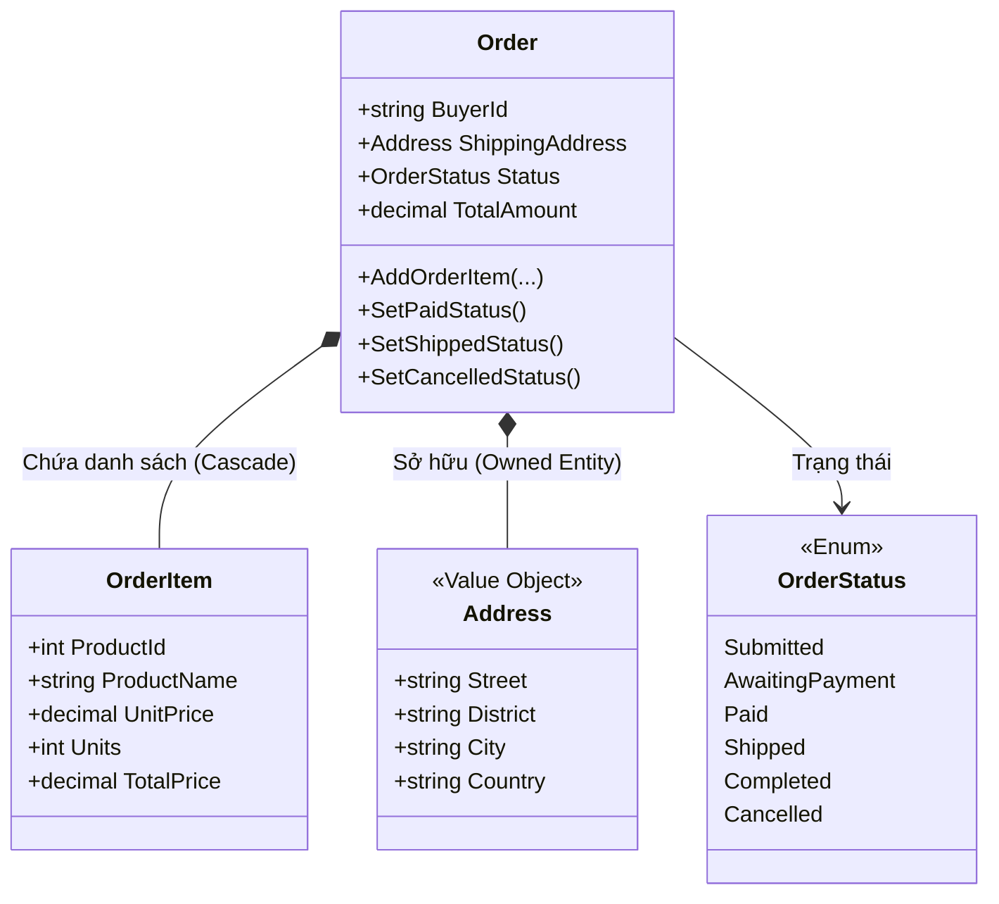
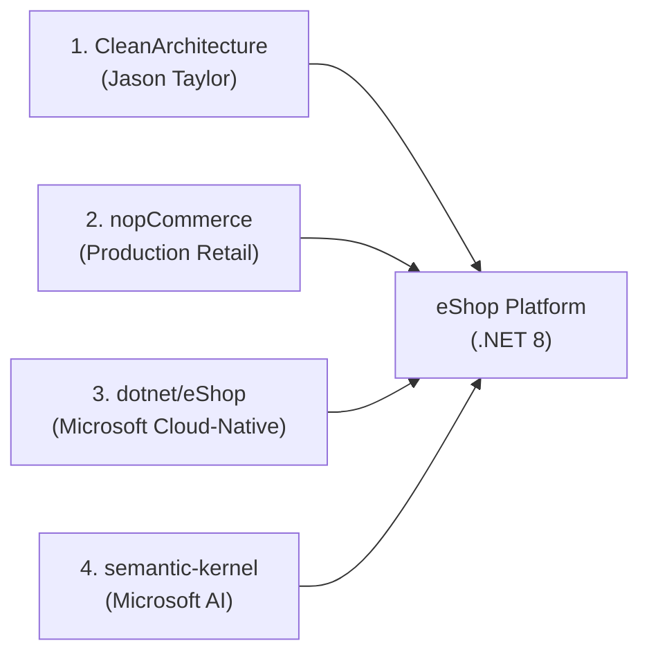

# 📚 SỔ TAY HỌC TẬP & TỪ ĐIỂN KIẾN TRÚC .NET THỰC CHIẾN (ESHOP)
> **Mục tiêu:** Vừa tự tay code một hệ thống eCommerce hiện đại, vừa hiểu sâu bản chất mọi khái niệm kỹ thuật qua bộ câu hỏi: **"Là gì? — Được định nghĩa như thế nào? — Dùng để làm gì trong thực tế?"**.

---

## MỤC LỤC
1. [Bảng Tra Cứu Thuật Ngữ Anh - Việt (Quick Glossary)](#1-bảng-tra-cứu-thuật-ngữ-anh---việt-quick-glossary)
2. [Giải Mã Chi Tiết Các Khái Niệm Kiến Trúc (Là gì? Định nghĩa thế nào? Làm gì?)](#2-giải-mã-chi-tiết-các-khái-niệm-kiến-trúc)
   - [2.1. Clean Architecture (Kiến trúc Sạch)](#21-clean-architecture-kiến-trúc-sạch)
   - [2.2. Dependency Inversion Principle - DIP (Nguyên lý Đảo ngược Phụ thuộc)](#22-dependency-inversion-principle---dip-nguyên-lý-đảo-ngược-phụ-thuộc)
   - [2.3. CQRS (Phân tách Trách nhiệm Lệnh và Truy vấn)](#23-cqrs-phân-tách-trách-nhiệm-lệnh-và-truy-vấn)
   - [2.4. Mediator Pattern & Thư viện MediatR](#24-mediator-pattern--thư-viện-mediatr)
   - [2.5. Pipeline Behaviors (Hành vi Đường ống)](#25-pipeline-behaviors-hành-vi-đường-ống)
   - [2.6. Domain-Driven Design - DDD (Thiết kế Hướng Miền)](#26-domain-driven-design---ddd-thiết-kế-hướng-miền)
   - [2.7. Domain Events (Sự kiện Miền)](#27-domain-events-sự-kiện-miền)
   - [2.8. Audit Trail (Nhật ký Kiểm toán Dữ liệu)](#28-audit-trail-nhật-ký-kiểm-toán-dữ-liệu)
   - [2.9. Global Exception Handling & RFC 7807 (Xử lý Ngoại lệ Toàn cục)](#29-global-exception-handling--rfc-7807-xử-lý-ngoại-lệ-toàn-cục)
   - [2.10. ORM & Entity Framework Core (Code-First, Migration, Fluent API)](#210-orm--entity-framework-core-code-first-migration-fluent-api)
   - [2.11. In-Memory Cache & Redis](#211-in-memory-cache--redis)
   - [2.12. Message Broker & RabbitMQ (Giao tiếp Hướng Sự kiện)](#212-message-broker--rabbitmq-giao-tiếp-hướng-sự-kiện)
   - [2.13. Semantic Kernel & AI (LLM, RAG, Function Calling)](#213-semantic-kernel--ai-llm-rag-function-calling)
3. [Bóc Tách Từng Tệp Mã Nguồn Đã Viết Trong Sprint 0](#3-bóc-tách-từng-tệp-mã-nguồn-đã-viết-trong-sprint-0)
4. [Góc Phỏng Vấn Tuyển Dụng (Sprint 0 QA)](#4-góc-phỏng-vấn-tuyển-dụng-sprint-0-qa)
5. [Sprint 1: Module Catalog & Database PostgreSQL](#5-sprint-1-module-catalog--database-postgresql-chi-tiết-bóc-tách-kỹ-thuật)
6. [Sprint 2: Giỏ Hàng Siêu Tốc Với In-Memory Cache & Redis](#6-sprint-2-giỏ-hàng-siêu-tốc-với-in-memory-cache--redis)
7. [Sprint 3: Xử Lý Đơn Hàng (Ordering) & Domain-Driven Design (DDD)](#7-sprint-3-xử-lý-đơn-hàng-ordering--domain-driven-design-ddd)
8. [Sprint 4: Asynchronous Event-Driven Với RabbitMQ & MassTransit](#8-sprint-4-asynchronous-event-driven-với-rabbitmq--masstransit-học-từ-eshop)
9. [Sprint 5: Trí Tuệ Nhân Tạo Semantic Kernel & AI Shopping Assistant](#9-sprint-5-trí-tuệ-nhân-tạo-semantic-kernel--ai-shopping-assistant-học-từ-semantic-kernel)
10. [Sprint 6: Giao Diện Web Blazor App, .NET Aspire & Đóng Gói Docker Compose](#10-sprint-6-giao-diện-web-blazor-app-net-aspire--đóng-gói-docker-compose)
11. [Tổng Kết Đỉnh Cao: Chinh Phục Trọn Vẹn 4 Repositories & Giá Trị CV](#11-tổng-kết-đỉnh-cao-chinh-phục-trọn-vẹn-4-repositories--giá-trị-cv)

---

## 1. BẢNG TRA CỨU THUẬT NGỮ ANH - VIỆT (QUICK GLOSSARY)

| Thuật ngữ Tiếng Anh | Bản dịch / Thuật ngữ Tiếng Việt | Ý nghĩa vắn tắt |
| :--- | :--- | :--- |
| **Clean Architecture** | Kiến trúc Sạch | Cách chia code thành nhiều tầng độc lập, bảo vệ lõi nghiệp vụ. |
| **Domain** | Miền nghiệp vụ | Trái tim của ứng dụng, chứa toàn bộ luật kinh doanh và dữ liệu cốt lõi. |
| **Bounded Context** | Ngữ cảnh Giới hạn | Phạm vi ranh giới của một phân hệ nghiệp vụ (vd: Giỏ hàng tách rời Đơn hàng). |
| **Entity** | Thực thể | Đối tượng có danh tính duy nhất (Id), thay đổi thuộc tính nhưng Id không đổi. |
| **Value Object** | Đối tượng Giá trị | Đối tượng không có Id, hai đối tượng giống nhau nếu mọi giá trị bằng nhau (vd: Tiền, Địa chỉ). |
| **Aggregate Root** | Gốc Cụm | Thực thể đầu não quản lý một nhóm các thực thể con phụ thuộc. |
| **Domain Event** | Sự kiện Miền | Biến cố nghiệp vụ đã xảy ra trong quá khứ bên trong hệ thống (vd: Đơn hàng đã tạo). |
| **CQRS** | Phân tách Lệnh và Truy vấn | Tách riêng code đọc dữ liệu (Query) và code ghi/sửa dữ liệu (Command). |
| **Mediator** | Bộ trung gian điều phối | Đối tượng nhận yêu cầu và tìm đúng người xử lý, các bên không gọi trực tiếp nhau. |
| **Pipeline Behavior** | Hành vi Đường ống | Đoạn code tự động chặn trước/sau một yêu cầu (giống như Middleware trong tầng ứng dụng). |
| **Validation** | Kiểm tra tính hợp lệ | Đảm bảo dữ liệu người dùng gửi lên đúng quy chuẩn trước khi lưu vào DB. |
| **Audit Trail** | Vết kiểm toán | Lịch sử ghi nhớ ai tạo, tạo lúc nào, ai sửa, sửa lúc nào. |
| **Exception Handling** | Xử lý ngoại lệ / Lỗi | Cơ chế bắt lỗi tập trung, không để ứng dụng bị crash hay lộ thông tin nhạy cảm. |
| **ProblemDetails (RFC 7807)** | Định dạng Chi tiết Sự cố | Tiêu chuẩn quốc tế về cấu trúc JSON báo lỗi trong REST API. |
| **ORM (Object-Relational Mapping)** | Ánh xạ Đối tượng - Quan hệ | Công cụ giúp code C# thao tác với bảng DB mà không cần gõ SQL thủ công. |
| **Migration** | Di chuyển / Nâng cấp DB | Bản ghi vết thay đổi cấu trúc bảng C# được dịch thành mã SQL cập nhật DB. |
| **In-Memory Cache** | Bộ nhớ đệm trong RAM | Lưu dữ liệu trực tiếp trên RAM để truy xuất siêu tốc (micro-giây). |
| **Message Broker** | Bộ môi giới tin nhắn | Hệ thống trung gian xếp hàng nhận và phát tin nhắn giữa các dịch vụ (vd: RabbitMQ). |
| **Event-Driven Architecture** | Kiến trúc Hướng Sự kiện | Các dịch vụ giao tiếp bằng cách phát ra sự kiện và lắng nghe sự kiện của nhau. |
| **Outbox Pattern** | Mẫu Hộp thư đi | Kỹ thuật đảm bảo lưu DB thành công thì chắc chắn tin nhắn sẽ được gửi vào Message Broker. |
| **RAG (Retrieval-Augmented Generation)** | Tạo sinh Tăng cường Truy xuất | Kỹ thuật đưa tài liệu riêng của công ty cho AI đọc rồi mới yêu cầu AI trả lời. |
| **Function Calling / Tool Calling** | Gọi hàm C# tự động | Khả năng AI tự nhận biết khi nào cần gọi một hàm C# để tra cứu dữ liệu thời gian thực. |

---

## 2. GIẢI MÃ CHI TIẾT CÁC KHÁI NIỆM KIẾN TRÚC

---

### 2.1. Clean Architecture (Kiến trúc Sạch)

#### 🔹 Là gì?
Clean Architecture là một mô hình kiến trúc phần mềm do Robert C. Martin (Uncle Bob) khởi xướng và được cộng đồng .NET (tiêu biểu là Jason Taylor) chuẩn hóa. Nó tổ chức mã nguồn thành các vòng tròn đồng tâm, trong đó **logic nghiệp vụ (Domain)** nằm ở tâm điểm và hoàn toàn độc lập với các công nghệ bên ngoài (Database, Giao diện, Thư viện bên thứ ba).

#### 🔹 Được định nghĩa như thế nào trong Solution của chúng ta?
Hệ thống được chia thành 4 project C# phân tầng rõ rệt:
1. `eShop.Domain`: Không có bất kỳ dependency nào từ bên ngoài, chỉ chứa C# thuần (`Entities`, `ValueObjects`, `Exceptions`, `Enums`).
2. `eShop.Application`: Chỉ phụ thuộc vào `eShop.Domain`. Chứa các ca sử dụng (Use Cases), Commands, Queries, DTOs, Validators và Interfaces.
3. `eShop.Infrastructure`: Phụ thuộc vào `eShop.Application`. Triển khai các Interface (Database EF Core PostgreSQL, Redis, RabbitMQ, Email).
4. `eShop.API`: Phụ thuộc vào `eShop.Application` và `eShop.Infrastructure`. Đóng vai trò là điểm vào của ứng dụng (Host, Controllers/Minimal APIs, Swagger).

```
   [ eShop.API ]  --->  [ eShop.Infrastructure ]
        |                         |
        v                         v
   [ eShop.Application ]  --------+
        |
        v
   [ eShop.Domain ] (Trung tâm - Zero Dependency)
```

#### 🔹 Làm gì trong thực tế?
- **Độc lập cơ sở dữ liệu:** Bạn có thể đổi từ PostgreSQL sang SQL Server, MongoDB mà không cần sửa 1 dòng code logic nào trong `Domain` và `Application`.
- **Dễ dàng kiểm thử (Testability):** Bạn có thể viết Unit Test cho toàn bộ nghiệp vụ mà không cần bật database thật.
- **Bền vững theo thời gian:** Công nghệ bên ngoài có lỗi thời (vd: đổi từ REST sang gRPC hay GraphQL) thì lõi nghiệp vụ vẫn nguyên vẹn.

---

### 2.2. Dependency Inversion Principle - DIP (Nguyên lý Đảo ngược Phụ thuộc)

#### 🔹 Là gì?
Chữ **D** trong nguyên lý vàng **SOLID**. Nguyên lý này phát biểu:
1. Các module cấp cao (Application/Domain) không được phụ thuộc vào các module cấp thấp (Infrastructure/Database). Cả hai phải phụ thuộc vào sự trừu tượng (**Abstractions / Interfaces**).
2. Sự trừu tượng không được phụ thuộc vào chi tiết. Chi tiết phải phụ thuộc vào sự trừu tượng.

#### 🔹 Được định nghĩa như thế nào?
- Ở tầng `Application`, ta chỉ định nghĩa Interface:
  ```csharp
  public interface IBasketRepository
  {
      Task<CustomerBasket?> GetBasketAsync(string customerId);
      Task<CustomerBasket> UpdateBasketAsync(CustomerBasket basket);
  }
  ```
- Tầng `Infrastructure` mới là nơi viết code thực thi sử dụng Redis:
  ```csharp
  public class RedisBasketRepository : IBasketRepository
  {
      private readonly IDatabase _database; // Kết nối Redis thật
      // ...
  }
  ```

#### 🔹 Làm gì trong thực tế?
Giúp code không bị "dính chặt" (decoupled). Khi viết Unit Test cho `Application`, ta chỉ việc mock interface `IBasketRepository` với dữ liệu giả lập trong bộ nhớ mà không cần kết nối tới Redis thật.

---

### 2.3. CQRS (Phân tách Trách nhiệm Lệnh và Truy vấn)

#### 🔹 Là gì?
**CQRS (Command Query Responsibility Segregation)** là mẫu thiết kế chia các hành động của hệ thống thành hai nhóm hoàn toàn tách biệt:
1. **Command (Lệnh):** Thay đổi trạng thái dữ liệu (Thêm, Sửa, Xóa). Trả về thành công/thất bại hoặc Id của đối tượng mới tạo, không nên trả về cả cây dữ liệu lớn.
2. **Query (Truy vấn):** Chỉ đọc dữ liệu (Xem danh sách, Xem chi tiết). Tuyệt đối **không làm thay đổi** bất kỳ dữ liệu nào trong database.

#### 🔹 Được định nghĩa như thế nào?
- Một Command:
  ```csharp
  public record CreateProductCommand(string Name, decimal Price, int Stock) : IRequest<int>;
  ```
- Một Query:
  ```csharp
  public record GetProductsQuery(int PageIndex, int PageSize) : IRequest<PaginatedList<ProductDto>>;
  ```

#### 🔹 Làm gì trong thực tế?
- Cho phép tối ưu hóa riêng biệt:
  - Khi đọc (Query): Dùng `.AsNoTracking()`, Dapper hoặc đọc trực tiếp từ Redis/Read-Replica để đạt tốc độ cao nhất.
  - Khi ghi (Command): Kèm theo đầy đủ các bước kiểm tra (Validation), xử lý Transaction, kiểm soát xung đột dữ liệu (Concurrency).
- Tránh việc một hàm vừa sửa database vừa select dữ liệu phức tạp gây chậm hệ thống.

---

### 2.4. Mediator Pattern & Thư viện MediatR

#### 🔹 Là gì?
- **Mediator Pattern:** Mẫu thiết kế phân tán kết nối: Thay vì Service A gọi trực tiếp Service B, Service B gọi Service C (gây ra mạng lưới phụ thuộc chằng chịt hình mạng nhện), tất cả các đối tượng sẽ gửi tin nhắn qua một **Bộ trung gian (Mediator)**.
- **MediatR:** Thư viện C# phổ biến nhất hiện nay hiện thực hóa Mediator Pattern cho ứng dụng .NET.

```
Mô hình cũ (Spaghetti):
[Controller] ---> [ProductService] ---> [CategoryService] ---> [Repository]

Mô hình Mediator:
[Controller] ---> [ MediatR ] ---> [ Đúng Handler Phù Hợp ]
```

#### 🔹 Được định nghĩa như thế nào?
- Tạo một yêu cầu (Request): Triển khai `IRequest<TResponse>`.
- Tạo bộ xử lý (Handler): Triển khai `IRequestHandler<TRequest, TResponse>`.
- Tại API, chỉ cần gọi một dòng duy nhất:
  ```csharp
  var result = await _mediator.Send(command);
  ```

#### 🔹 Làm gì trong thực tế?
- Controller / Minimal API cực kỳ mỏng và gọn, không bị phình to (Fat Controller).
- Mỗi chức năng (Use Case) gói gọn trong một file Handler duy nhất $\rightarrow$ Khi nhiều lập trình viên cùng làm việc, không ai dẫm chân lên code của nhau (hạn chế tối đa Git merge conflicts).

---

### 2.5. Pipeline Behaviors (Hành vi Đường ống)

#### 🔹 Là gì?
Là cơ chế của MediatR cho phép chèn các đoạn code xử lý dùng chung (Cross-Cutting Concerns) bọc xung quanh mọi Handler, hoạt động theo mô hình vỏ củ hành (Onion Layers).

#### 🔹 Được định nghĩa như thế nào?
Triển khai interface `IPipelineBehavior<TRequest, TResponse>`:
```csharp
public class ValidationBehavior<TRequest, TResponse> : IPipelineBehavior<TRequest, TResponse>
{
    public async Task<TResponse> Handle(TRequest request, RequestHandlerDelegate<TResponse> next, ...)
    {
        // 1. Chạy TRƯỚC khi vào Handler (vd: kiểm tra dữ liệu bằng FluentValidation)
        // ...
        var response = await next(); // 2. Gọi Handler chính thức
        // 3. Chạy SAU khi Handler hoàn thành (vd: ghi log thời gian kết thúc)
        return response;
    }
}
```

#### 🔹 Làm gì trong thực tế?
- Tự động hóa: Không cần viết lệnh validate hay đo thời gian lặp đi lặp lại ở 100 API khác nhau.
- Tập trung hóa: Mọi request gửi qua MediatR đều bắt buộc phải vượt qua bài kiểm tra của đường ống trước khi đến được logic nghiệp vụ.

---

### 2.6. Domain-Driven Design - DDD (Thiết kế Hướng Miền)

#### 🔹 Là gì?
Là phương pháp luận thiết kế phần mềm lấy **mô hình nghiệp vụ thực tế** làm trọng tâm. Trong DDD, ta phân loại rõ các thành phần:

1. **Entity (Thực thể):**
   * *Định nghĩa:* Đối tượng có định danh duy nhất (`Id`).
   * *Đặc tính:* Dù khách hàng có đổi tên, đổi số điện thoại, đổi địa chỉ thì đối tượng `Customer` đó vẫn là một người duy nhất vì `CustomerId` không đổi.
2. **Value Object (Đối tượng Giá trị):**
   * *Định nghĩa:* Đối tượng **không có Id**, được xác định hoàn toàn bởi giá trị của các thuộc tính bên trong nó.
   * *Đặc tính:* Tính bất biến (Immutable). Ví dụ: `Money(Amount: 50000, Currency: "VND")` hoặc `Address(Street, City)`. Nếu hai tờ tiền cùng mệnh giá 50.000 VNĐ thì chúng có giá trị như nhau. Muốn đổi giá trị, ta tạo đối tượng mới chứ không sửa đối tượng cũ.
3. **Aggregate Root (Gốc Cụm):**
   * *Định nghĩa:* Thực thể đầu não chịu trách nhiệm bảo vệ tính nhất quán dữ liệu cho một nhóm các thực thể phụ thuộc.
   * *Ví dụ:* `Order` (Đơn hàng) là Aggregate Root, còn `OrderItem` (Chi tiết dòng đơn hàng) là thực thể con bên trong. Bên ngoài không được phép thêm trực tiếp `OrderItem` vào database mà phải thông qua hàm `Order.AddOrderItem(...)`.

---

### 2.7. Domain Events (Sự kiện Miền)

#### 🔹 Là gì?
Là một thông điệp ghi lại một sự kiện nghiệp vụ **đã diễn ra trong quá khứ** bên trong phạm vi Domain (tên sự kiện luôn đặt ở thể quá khứ: `OrderCreatedEvent`, `StockDepletedEvent`).

#### 🔹 Được định nghĩa như thế nào?
- Interface: `public interface IDomainEvent { DateTime OccurredOnUtc { get; } }`
- Entity lưu trữ sự kiện:
  ```csharp
  public void CompleteOrder()
  {
      this.Status = OrderStatus.Completed;
      this.AddDomainEvent(new OrderCompletedDomainEvent(this.Id));
  }
  ```

#### 🔹 Làm gì trong thực tế?
Giúp tách rời các hành động phụ thuộc (Decoupling): Khi đơn hàng hoàn tất, Domain chỉ cần bắn ra sự kiện `OrderCompletedDomainEvent`. Các thành phần khác (tích điểm khách hàng, trừ kho, gửi thông báo) sẽ độc lập lắng nghe sự kiện này và tự chạy mà không làm code của `Order` bị phình to.

---

### 2.8. Audit Trail (Nhật ký Kiểm toán Dữ liệu)

#### 🔹 Là gì?
Cơ chế tự động ghi nhận dấu vết thay đổi của từng dòng dữ liệu trong cơ sở dữ liệu: Tạo bởi ai? Tạo khi nào? Ai sửa đổi gần nhất? Vào lúc nào?

#### 🔹 Được định nghĩa như thế nào trong code của chúng ta?
* Kế thừa lớp [`BaseAuditableEntity`](file:///d:/eShop/src/eShop.Domain/Common/BaseAuditableEntity.cs):
  * `CreatedAtUtc`: Thời điểm tạo bản ghi (UTC).
  * `CreatedBy`: Mã người dùng hoặc hệ thống tạo.
  * `LastModifiedAtUtc`: Thời điểm sửa đổi mới nhất.
  * `LastModifiedBy`: Người thực hiện sửa đổi mới nhất.

#### 🔹 Làm gì trong thực tế?
- Đáp ứng tiêu chuẩn an toàn thông tin doanh nghiệp (Compliance & Security).
- Hỗ trợ gỡ lỗi và truy tìm nguyên nhân khi dữ liệu bị sửa đổi trái phép hoặc nhầm lẫn.

---

### 2.9. Global Exception Handling & RFC 7807 (Xử lý Ngoại lệ Toàn cục)

#### 🔹 Là gì?
- **Global Exception Handling:** Một chốt chặn duy nhất tại tầng API để bắt mọi lỗi phát sinh (dù là lỗi người dùng nhập sai, lỗi không tìm thấy dữ liệu hay lỗi sập database).
- **RFC 7807 (`ProblemDetails`):** Chuẩn đặc tả của Internet Engineering Task Force (IETF) quy định cấu trúc trả về thống nhất cho các lỗi HTTP API.

#### 🔹 Cấu trúc JSON chuẩn RFC 7807 trông như thế nào?
```json
{
  "type": "https://datatracker.ietf.org/doc/html/rfc7231#section-6.5.1",
  "title": "Dữ liệu yêu cầu không hợp lệ",
  "status": 400,
  "instance": "/api/products",
  "errors": {
    "Price": ["Giá sản phẩm phải lớn hơn 0."]
  }
}
```

#### 🔹 Làm gì trong thực tế?
- Bảo mật: Không bao giờ để lộ vết mã nguồn (Stack Trace) ra môi trường Production (hacker có thể lợi dụng để tấn công).
- Tính chuyên nghiệp: Giúp lập trình viên Frontend (Web/Mobile) chỉ cần viết 1 hàm xử lý lỗi duy nhất cho toàn bộ hệ thống.

---

### 2.10. ORM & Entity Framework Core (Code-First, Migration, Fluent API)

#### 🔹 Là gì?
- **ORM (Object-Relational Mapping):** Cầu nối dịch các class C# thành các bảng quan hệ trong SQL.
- **EF Core:** ORM chính thức của Microsoft cho .NET.
- **Code-First:** Phương pháp lập trình mà bạn viết class C# trước, sau đó EF Core sẽ tự động sinh mã SQL để tạo bảng trong Database tương ứng.
- **Migration:** Bản chụp (Snapshot) theo dõi từng bước thay đổi của Model C# theo thời gian để cập nhật database một cách an toàn mà không làm mất dữ liệu cũ.
- **Fluent API:** Cách cấu hình chi tiết bảng database (độ dài cột, khóa chính, khóa ngoại, index) thông qua code C# ghi đè phương thức `OnModelCreating`, giúp giữ cho các Entity Domain hoàn toàn "sạch", không bị dính các Attribute lạ.

---

### 2.11. In-Memory Cache & Redis

#### 🔹 Là gì?
- **Redis (Remote Dictionary Server):** Một hệ cơ sở dữ liệu In-Memory (lưu dữ liệu hoàn toàn trên RAM) dạng Key-Value mã nguồn mở siêu nhanh, hỗ trợ cấu trúc dữ liệu phong phú (String, Hash, List, Set).
- **TTL (Time-To-Live):** Thời gian sống của dữ liệu trong Cache. Sau khoảng thời gian này, Redis tự động giải phóng dữ liệu khỏi bộ nhớ.

#### 🔹 Làm gì trong dự án eShop?
- **Giỏ hàng (`Basket.API`):** Khi người mua thêm hàng vào giỏ, ta lưu ngay vào Redis với TTL là 30 ngày. Tốc độ đọc/ghi đạt hàng chục ngàn thao tác mỗi giây mà không làm nghẽn database PostgreSQL chính.
- **Session & Caching:** Lưu trữ danh sách sản phẩm xem nhiều để người dùng tải trang tức thì.

---

### 2.12. Message Broker & RabbitMQ (Giao tiếp Hướng Sự kiện)

#### 🔹 Là gì?
- **Message Broker:** Hệ thống trung gian đóng vai trò như một "bưu cục". Một service gửi tin nhắn vào hộp thư (Queue/Exchange), các service khác khi nào rảnh sẽ đến lấy thư ra đọc.
- **RabbitMQ:** Phần mềm Message Broker phổ biến nhất thế giới hỗ trợ giao thức AMQP.
- **MassTransit:** Thư viện .NET cao cấp giúp trừu tượng hóa RabbitMQ, hỗ trợ cơ chế tự động thử lại (Retry), chuyển thư lỗi vào hòm thư chết (Dead-letter Queue) và Outbox Pattern.

#### 🔹 Làm gì trong thực tế?
Giải quyết bài toán **nghẽn hệ thống khi thanh toán**:
1. Khách bấm nút "Đặt hàng".
2. Hệ thống tạo đơn hàng $\rightarrow$ Phản hồi ngay cho khách: *"Đặt hàng thành công!"* (mất 50ms).
3. Hệ thống bắn 1 tin nhắn `OrderPlacedEvent` vào RabbitMQ.
4. Ở phía sau (background):
   * Service Kho hàng nhận tin nhắn $\rightarrow$ trừ tồn kho.
   * Service Email nhận tin nhắn $\rightarrow$ xuất PDF hóa đơn và gửi email cho khách.
   * Service Thống kê nhận tin nhắn $\rightarrow$ cập nhật biểu đồ doanh thu.
$\Rightarrow$ Nếu hệ thống gửi email bị sập, khách hàng vẫn đặt hàng bình thường và email sẽ được gửi bù khi service email hoạt động trở lại!

---

### 2.13. Semantic Kernel & AI (LLM, RAG, Function Calling)

#### 🔹 Là gì?
- **Semantic Kernel:** SDK mã nguồn mở do chính Microsoft phát triển cho phép lập trình viên C# tích hợp các mô hình trí tuệ nhân tạo (OpenAI, Gemini, Ollama) vào ứng dụng backend doanh nghiệp.
- **LLM (Large Language Model):** Mô hình ngôn ngữ lớn (trí tuệ nhân tạo có khả năng hiểu và sinh ngôn ngữ tự nhiên).
- **Function Calling (Gọi hàm C# tự động):** Khả năng mà AI tự đọc tài liệu về các hàm C# bạn cung cấp, tự quyết định khi nào cần gọi hàm nào với tham số là gì để lấy dữ liệu thực tế.
- **RAG (Retrieval-Augmented Generation):** Kỹ thuật trích xuất thông tin từ tài liệu nội bộ công ty (qua Vector Search) rồi nhồi vào câu hỏi để AI trả lời chính xác, tránh hiện tượng AI "bốc phét" (ảo giác/hallucination).

---

## 3. BÓC TÁCH CHI TIẾT TỪNG TỆP TIN (FILE) HIỆN CÓ TRONG DỰ ÁN

Mỗi file trong dự án đều tuân thủ triệt để nguyên lý Đơn trách nhiệm (**Single Responsibility Principle**). Dưới đây là phân tích chi tiết toàn bộ các file từ trong lõi ra ngoài theo 4 tầng Clean Architecture:

---

### 3.1. Tệp Gốc Solution & Cấu Hình Chung

* **[eShop.sln](file:///d:/eShop/eShop.sln):**
  * *Là gì:* Tệp giải pháp (Solution File) của Microsoft .NET.
  * *Nhiệm vụ:* Tập hợp 6 project con (`Domain`, `Application`, `Infrastructure`, `API`, `Web`, `UnitTests`) vào chung một solution. Trình biên dịch sử dụng file này để xác định thứ tự build và thiết lập liên kết giữa các project.
* **[LEARNING.md](file:///d:/eShop/LEARNING.md):**
  * *Là gì:* Sổ tay học tập và tài liệu giải nghĩa toàn diện của dự án.
  * *Nhiệm vụ:* Lưu giữ toàn bộ kiến thức, dịch thuật tiếng Việt, giải thích cấu trúc mã nguồn và câu hỏi phỏng vấn theo từng Sprint.

---

### 3.2. Tầng 1: `src/eShop.Domain` (Lõi Nghiệp Vụ - Zero Dependency)

* **[eShop.Domain.csproj](file:///d:/eShop/src/eShop.Domain/eShop.Domain.csproj):**
  * *Là gì:* Tệp cấu hình dự án thư viện C# (Class Library) chạy trên nền `.NET 8`.
  * *Đặc điểm:* Hoàn toàn không chứa bất kỳ gói NuGet phụ thuộc (`<PackageReference>`) nào bên ngoài. Đây là nguyên tắc cốt tử: *Domain phải là C# thuần khiết*.
* **[Common/IDomainEvent.cs](file:///d:/eShop/src/eShop.Domain/Common/IDomainEvent.cs):**
  * *Là gì:* Interface đánh dấu một sự kiện nghiệp vụ nội bộ (Marker Interface).
  * *Cấu trúc:* Chứa thuộc tính `DateTime OccurredOnUtc { get; }` ghi lại thời điểm sự kiện phát sinh theo giờ chuẩn quốc tế UTC.
  * *Làm gì:* Đảm bảo mọi sự kiện nghiệp vụ sau này (`OrderPlacedEvent`, `ProductOutOfStockEvent`) đều có chuẩn chung để thu thập và xử lý.
* **[Common/BaseEntity.cs](file:///d:/eShop/src/eShop.Domain/Common/BaseEntity.cs):**
  * *Là gì:* Lớp trừu tượng (`abstract class`) làm nền móng cho mọi Entity trong hệ thống.
  * *Cấu trúc:*
    * `public TId Id { get; set; }`: Định danh duy nhất cho thực thể (hỗ trợ kiểu linh hoạt như `int`, `long`, `Guid`).
    * `private readonly List<IDomainEvent> _domainEvents`: Danh sách nội bộ lưu giữ các sự kiện nghiệp vụ.
    * `IReadOnlyCollection<IDomainEvent> DomainEvents`: Cho phép bên ngoài đọc danh sách nhưng ngăn chặn việc sửa đổi trực tiếp từ bên ngoài (tính đóng gói Encapsulation).
    * `AddDomainEvent()`, `RemoveDomainEvent()`, `ClearDomainEvents()`: Quản lý vòng đời sự kiện của Entity.
  * *Làm gì:* Giúp mọi đối tượng nghiệp vụ có thể tự phát sinh các biến cố mà không cần phụ thuộc vào thư viện bên ngoài.
* **[Common/BaseAuditableEntity.cs](file:///d:/eShop/src/eShop.Domain/Common/BaseAuditableEntity.cs):**
  * *Là gì:* Lớp mở rộng từ `BaseEntity` phục vụ mục đích kiểm toán (Audit Trail).
  * *Cấu trúc:* Bổ sung 4 thuộc tính: `CreatedAtUtc`, `CreatedBy`, `LastModifiedAtUtc`, `LastModifiedBy`.
  * *Làm gì:* Tự động lưu vết ai đã tạo bản ghi này vào lúc nào, và ai là người chỉnh sửa lần cuối, đáp ứng tiêu chuẩn an toàn dữ liệu doanh nghiệp.

---

### 3.3. Tầng 2: `src/eShop.Application` (Điều Phối Nghiệp Vụ & CQRS)

* **[eShop.Application.csproj](file:///d:/eShop/src/eShop.Application/eShop.Application.csproj):**
  * *Là gì:* Project quản lý các ca sử dụng (Use Cases).
  * *Gói thư viện tích hợp:*
    * `MediatR`: Thư viện điều phối Mediator Pattern phục vụ CQRS.
    * `FluentValidation` & `FluentValidation.DependencyInjectionExtensions`: Thư viện kiểm tra tính hợp lệ của dữ liệu đầu vào.
    * Tham chiếu trực tiếp: `<ProjectReference Include="..\eShop.Domain\eShop.Domain.csproj" />`.
* **[Common/Exceptions/ValidationException.cs](file:///d:/eShop/src/eShop.Application/Common/Exceptions/ValidationException.cs):**
  * *Là gì:* Ngoại lệ tùy chỉnh ném ra khi dữ liệu gửi lên vi phạm quy tắc validation.
  * *Cấu trúc:* Chứa từ điển `IDictionary<string, string[]> Errors` gom nhóm lỗi theo từng tên trường (Property Name).
  * *Làm gì:* Đóng gói toàn bộ lỗi của một form nhập liệu phức tạp để gửi về cho frontend hiển thị bên dưới từng ô input.
* **[Common/Exceptions/NotFoundException.cs](file:///d:/eShop/src/eShop.Application/Common/Exceptions/NotFoundException.cs):**
  * *Là gì:* Ngoại lệ ném ra khi không tìm thấy thực thể trong cơ sở dữ liệu.
  * *Làm gì:* Báo hiệu cho tầng API biết để chuyển đổi thành phản hồi HTTP 404 Not Found.
* **[Common/Behaviors/ValidationBehavior.cs](file:///d:/eShop/src/eShop.Application/Common/Behaviors/ValidationBehavior.cs):**
  * *Là gì:* Pipeline Behavior của MediatR hoạt động như chốt chặn tự động kiểm tra tính hợp lệ của mọi Command/Query.
  * *Cấu trúc:* Triển khai `IPipelineBehavior<TRequest, TResponse>`.
  * *Làm gì:* Tự động quét và thực thi mọi `IValidator<TRequest>`. Nếu phát hiện bất kỳ lỗi nào, ném ra ngay `ValidationException` để chặn request trước khi nó vào Handler, đảm bảo Handler luôn nhận dữ liệu sạch.
* **[Common/Behaviors/LoggingBehavior.cs](file:///d:/eShop/src/eShop.Application/Common/Behaviors/LoggingBehavior.cs):**
  * *Là gì:* Pipeline Behavior ghi log và giám sát hiệu năng.
  * *Cấu trúc:* Sử dụng `Stopwatch` đo thời gian từ khi bắt đầu nhận request đến lúc Handler trả kết quả.
  * *Làm gì:* Cảnh báo `LogWarning` nếu request chạy quá **500ms**, giúp lập trình viên phát hiện sớm các câu truy vấn database chạy chậm.
* **[DependencyInjection.cs](file:///d:/eShop/src/eShop.Application/DependencyInjection.cs):**
  * *Là gì:* Lớp mở rộng (Extension Method) để đăng ký tầng Application vào hệ thống DI container của .NET.
  * *Làm gì:* Chỉ cần một dòng lệnh `builder.Services.AddApplicationServices()`, toàn bộ Validators, MediatR Handlers và Behaviors sẽ được nạp tự động vào ứng dụng.

---

### 3.4. Tầng 3: `src/eShop.Infrastructure` (Hạ Tầng Kết Nối Ngoại Vi)

* **[eShop.Infrastructure.csproj](file:///d:/eShop/src/eShop.Infrastructure/eShop.Infrastructure.csproj):**
  * *Là gì:* Tệp cấu hình tầng hạ tầng bên ngoài.
  * *Gói thư viện tích hợp:*
    * `Npgsql.EntityFrameworkCore.PostgreSQL`: Bộ driver và ORM kết nối với PostgreSQL.
    * `Microsoft.EntityFrameworkCore.Tools`: Bộ công cụ dòng lệnh hỗ trợ chạy Migration DB.
    * Tham chiếu trực tiếp: `<ProjectReference Include="..\eShop.Application\eShop.Application.csproj" />`.
  * *Làm gì:* Sẵn sàng làm nơi hiện thực hóa DbContext, cấu hình bảng qua Fluent API, triển khai Redis Cache và RabbitMQ Message Bus trong các Sprint tiếp theo.

---

### 3.5. Tầng 4: `src/eShop.API` (Cổng Giao Tiếp HTTP / Web API Host)

* **[eShop.API.csproj](file:///d:/eShop/src/eShop.API/eShop.API.csproj):**
  * *Gói thư viện tích hợp:*
    * `Microsoft.AspNetCore.OpenApi`: Hỗ trợ giao thức OpenAPI chuẩn hóa.
    * `Swashbuckle.AspNetCore`: Giao diện tài liệu Swagger UI trực quan giúp test API trực tiếp trên trình duyệt.
    * `Microsoft.EntityFrameworkCore.Design`: Hỗ trợ công cụ EF Core sinh mã migration từ project chạy chính.
    * Tham chiếu trực tiếp: Tham chiếu cả `eShop.Application` và `eShop.Infrastructure`.
* **[Infrastructure/GlobalExceptionHandler.cs](file:///d:/eShop/src/eShop.API/Infrastructure/GlobalExceptionHandler.cs):**
  * *Là gì:* Bộ bắt lỗi tập trung toàn cục theo chuẩn `IExceptionHandler` của .NET 8.
  * *Làm gì:* Bắt mọi ngoại lệ chưa được xử lý trong pipeline HTTP:
    * Bắt `ValidationException` $\rightarrow$ Trả về HTTP 400 Bad Request kèm danh sách lỗi chi tiết.
    * Bắt `NotFoundException` $\rightarrow$ Trả về HTTP 404 Not Found.
    * Bắt các lỗi hệ thống khác $\rightarrow$ Trả về HTTP 500 Internal Server Error và ẩn thông tin nhạy cảm để bảo mật.
    * Toàn bộ lỗi được xuất ra theo cấu trúc chuẩn quốc tế **RFC 7807 (`ProblemDetails`)**.
* **[Program.cs](file:///d:/eShop/src/eShop.API/Program.cs):**
  * *Là gì:* Điểm khởi đầu (Entry Point) của Web API.
  * *Làm gì:*
    1. Kích hoạt tầng Application: `builder.Services.AddApplicationServices()`.
    2. Cấu hình Exception Handler: `builder.Services.AddExceptionHandler<GlobalExceptionHandler>()`.
    3. Cấu hình Swagger với mô tả dự án.
    4. Thiết lập Endpoint kiểm tra sức khỏe hệ thống: `GET /` (HealthCheck).
* **[appsettings.json](file:///d:/eShop/src/eShop.API/appsettings.json) & [appsettings.Development.json](file:///d:/eShop/src/eShop.API/appsettings.Development.json):**
  * *Là gì:* Tệp lưu trữ cấu hình môi trường chạy (chuỗi kết nối Database PostgreSQL, cấu hình Redis, mức độ ghi Log).
* **[Properties/launchSettings.json](file:///d:/eShop/src/eShop.API/Properties/launchSettings.json):**
  * *Là gì:* Quy định cấu hình cổng mạng (Port) cục bộ khi chạy debug trong Visual Studio / VS Code.
* **[eShop.API.http](file:///d:/eShop/src/eShop.API/eShop.API.http):**
  * *Là gì:* File kịch bản kiểm thử HTTP trực tiếp trong IDE mà không cần mở phần mềm Postman bên ngoài.

---

### 3.6. Tầng Trình Diễn: `src/eShop.Web` (Blazor Web App - 100% C#)

* **[eShop.Web.csproj](file:///d:/eShop/src/eShop.Web/eShop.Web.csproj) & [Program.cs](file:///d:/eShop/src/eShop.Web/Program.cs):**
  * *Là gì:* Dự án web giao diện người dùng sử dụng công nghệ Blazor Web App với chế độ tương tác Server (`InteractiveServerRenderMode`).
  * *Làm gì:* Cho phép lập trình giao diện động thời gian thực bằng mã C# thuần, không cần viết JavaScript.
* **[Components/App.razor](file:///d:/eShop/src/eShop.Web/Components/App.razor):**
  * *Là gì:* Trang gốc HTML chứa cấu trúc `<html>`, `<head>`, nạp CSS Bootstrap, script Blazor và thẻ `<Routes />`.
* **[Components/Routes.razor](file:///d:/eShop/src/eShop.Web/Components/Routes.razor):**
  * *Là gì:* Bộ định tuyến URL của Blazor, tự động điều hướng người dùng tới trang tương ứng khi gõ link trên trình duyệt.
* **[Components/_Imports.razor](file:///d:/eShop/src/eShop.Web/Components/_Imports.razor):**
  * *Là gì:* Nơi khai báo các câu lệnh `using` toàn cục dùng chung cho toàn bộ các trang giao diện `.razor`.
* **[Components/Layout/](file:///d:/eShop/src/eShop.Web/Components/Layout/):**
  * `MainLayout.razor` & `MainLayout.razor.css`: Bộ khung giao diện chung (Header, thanh Sidebar Menu và khu vực nội dung chính).
  * `NavMenu.razor` & `NavMenu.razor.css`: Thanh menu điều hướng các chức năng của website.
* **[Components/Pages/](file:///d:/eShop/src/eShop.Web/Components/Pages/):**
  * `Home.razor`: Trang chủ đón chào khách hàng.
  * `Counter.razor`: Trang ví dụ minh họa cơ chế bấm nút tăng số bằng C# tức thì mà không load lại trang.
  * `Weather.razor`: Trang ví dụ minh họa gọi lấy và kết xuất bảng dữ liệu.
  * `Error.razor`: Trang thông báo lỗi khi giao diện gặp trục trặc.
* **[wwwroot/](file:///d:/eShop/src/eShop.Web/wwwroot/):**
  * *Là gì:* Thư mục chứa các tài nguyên web tĩnh (Static Assets) như file CSS tùy chỉnh `app.css`, biểu tượng `favicon.png`, và thư viện CSS Bootstrap.

---

### 3.7. Tầng Kiểm Thử: `tests/eShop.UnitTests`

* **[eShop.UnitTests.csproj](file:///d:/eShop/tests/eShop.UnitTests/eShop.UnitTests.csproj):**
  * *Là gì:* Dự án kiểm thử tự động sử dụng framework xUnit hàng đầu của .NET.
  * *Tham chiếu:* Trực tiếp tới `eShop.Application` và `eShop.Domain` để kiểm thử logic nghiệp vụ.
* **[UnitTest1.cs](file:///d:/eShop/tests/eShop.UnitTests/UnitTest1.cs):**
  * *Là gì:* File kiểm thử mẫu, đã chạy pass thành công $100\%$ khi thực hiện lệnh `dotnet test`.

---

### 3.8. Sơ Đồ Luồng Xử Lý Của Một Request Qua Các File

```
[ Người Dùng / Trình Duyệt ]
            │
            ▼  (1. Gửi HTTP Request tới /api/...)
  [ Program.cs ]  ───►  [ GlobalExceptionHandler.cs ]  (Chốt chặn lỗi RFC 7807)
            │
            ▼  (2. Gửi qua MediatR)
    [ MediatR.Send ]
            │
            ▼  (3. Đi qua Pipeline Behavior thứ nhất)
  [ LoggingBehavior.cs ]  (Bắt đầu bấm giờ đo mili-giây)
            │
            ▼  (4. Đi qua Pipeline Behavior thứ hai)
 [ ValidationBehavior.cs ] (Quét các bộ Validator xem dữ liệu có hợp lệ không)
            │
            ▼  (5. Chuyển vào xử lý nghiệp vụ)
  [ Handler trong eShop.Application ]
            │
            ▼  (6. Thực thi quy tắc nghiệp vụ cốt lõi)
  [ Entity trong eShop.Domain ]  (Kế thừa BaseAuditableEntity & BaseEntity)
```

---

## 4. GÓC PHỎNG VẤN TUYỂN DỤNG (SPRINT 0 QA)

> **Hỏi: Tại sao chúng ta lại đặt Interface ở tầng `Application` mà phần hiện thực (Implementation) lại nằm ở `Infrastructure`?**
> * **Đáp:** Đây là ứng dụng thực tế của **Nguyên lý Đảo ngược Phụ thuộc (DIP)**. Tầng `Application` nắm giữ các quy trình nghiệp vụ nên nó có quyền "ra đề bài" (định nghĩa Interface: tôi cần một dịch vụ lưu giỏ hàng). Tầng `Infrastructure` chỉ là công nhân làm thuê hiện thực hóa đề bài đó (dùng Redis hay SQL Server). Làm như vậy giúp tầng Application không bị trói buộc vào bất kỳ hãng công nghệ cụ thể nào.

> **Hỏi: Pipeline Behavior trong MediatR khác gì với Middleware trong ASP.NET Core?**
> * **Đáp:**
>   - **Middleware:** Nằm ở tầng HTTP (ngoài cùng), xử lý các đối tượng `HttpContext`, `HttpRequest`, `HttpResponse`. Phù hợp cho xác thực JWT, nén dữ liệu (Gzip), CORS.
>   - **Pipeline Behavior:** Nằm sâu bên trong tầng ứng dụng (`Application`), xử lý các đối tượng nghiệp vụ cụ thể (`IRequest`, `IResponse`). Phù hợp cho Transaction database, Validate dữ liệu nghiệp vụ, Audit Log.

---

## 5. SPRINT 1: MODULE CATALOG & DATABASE POSTGRESQL (CHI TIẾT BÓC TÁCH KỸ THUẬT)

Module Catalog là phân hệ đầu tiên và quan trọng nhất của mọi sàn eCommerce, được xây dựng theo nghiệp vụ thực tế của **nopCommerce** và kiến trúc chuẩn của **Clean Architecture**.

---

### 5.1. Bóc Tách Thực Thể Nghiệp Vụ (Domain Layer)

* **[Brand.cs](file:///d:/eShop/src/eShop.Domain/Entities/Brand.cs) & [Category.cs](file:///d:/eShop/src/eShop.Domain/Entities/Category.cs):**
  * Đại diện cho Hãng sản xuất và Ngành hàng.
  * Thiết lập quan hệ 1 - N với `Product`.
* **[Product.cs](file:///d:/eShop/src/eShop.Domain/Entities/Product.cs):**
  * Kế thừa `BaseAuditableEntity`: Tự động có `CreatedAtUtc`, `LastModifiedAtUtc`.
  * **Rich Domain Model vs Anemic Domain Model:** Thay vì chỉ có các thuộc tính `{ get; set; }` thụ động (Anemic Model), `Product` chứa phương thức nghiệp vụ đóng gói:
    ```csharp
    public void UpdateStock(int adjustment)
    {
        var newQuantity = StockQuantity + adjustment;
        if (newQuantity < 0) throw new InvalidOperationException(...);
        StockQuantity = newQuantity;
        if (StockQuantity == 0)
        {
            AddDomainEvent(new ProductOutOfStockDomainEvent(Id, SKU));
        }
    }
    ```
    *Quy tắc:* Không được phép trừ kho âm. Nếu số lượng về 0 $\rightarrow$ Tự động kích hoạt sự kiện miền `ProductOutOfStockDomainEvent`.
* **[ProductOutOfStockDomainEvent.cs](file:///d:/eShop/src/eShop.Domain/Events/ProductOutOfStockDomainEvent.cs):**
  * Sự kiện báo hiệu sản phẩm đã hết sạch trong kho để sau này các service khác (Marketing, Thông báo quản trị viên) tự động lắng nghe.

---

### 5.2. Tầng Trừu Tượng & CQRS (Application Layer)

* **[IApplicationDbContext.cs](file:///d:/eShop/src/eShop.Application/Common/Interfaces/IApplicationDbContext.cs):**
  * Cầu nối trừu tượng giúp tầng Application truy cập các `DbSet<Product>`, `DbSet<Brand>`, `DbSet<Category>` mà không cần biết cơ sở dữ liệu bên dưới là gì.
* **[PaginatedList.cs](file:///d:/eShop/src/eShop.Application/Common/Models/PaginatedList.cs):**
  * Lớp phân trang tổng quát (Generic Pagination), cung cấp các metadata hữu ích: `PageIndex`, `TotalPages`, `TotalCount`, `HasPreviousPage`, `HasNextPage`.
* **Truy vấn Đọc (Query): [GetProductsWithPaginationQuery.cs](file:///d:/eShop/src/eShop.Application/Catalog/Queries/GetProductsWithPagination/GetProductsWithPaginationQuery.cs):**
  * Áp dụng triệt để **`.AsNoTracking()`**: Tắt tính năng Change Tracker của EF Core giúp truy vấn nhanh hơn gấp 2 lần và tiết kiệm một nửa dung lượng RAM.
  * Hỗ trợ tìm kiếm từ khóa (SearchTerm), lọc theo Brand, Category, khoảng giá và sắp xếp linh hoạt.
* **Lệnh Ghi (Command) & Kiểm Tra: [CreateProductCommand.cs](file:///d:/eShop/src/eShop.Application/Catalog/Commands/CreateProduct/CreateProductCommand.cs):**
  * Sử dụng **[CreateProductCommandValidator.cs](file:///d:/eShop/src/eShop.Application/Catalog/Commands/CreateProduct/CreateProductCommandValidator.cs)** để kiểm tra:
    * Tên không rỗng, tối đa 200 ký tự.
    * Mã SKU không rỗng, tối đa 50 ký tự, và **phải là duy nhất** trong database (`MustAsync(BeUniqueSKU)`).
    * Giá bán phải lớn hơn 0, tồn kho không được âm.
    * BrandId và CategoryId phải tồn tại trong cơ sở dữ liệu.
* **Lệnh Điều Chỉnh Kho: [UpdateProductStockCommand.cs](file:///d:/eShop/src/eShop.Application/Catalog/Commands/UpdateProductStock/UpdateProductStockCommand.cs):**
  * Gọi trực tiếp hàm nghiệp vụ `product.UpdateStock(request.Adjustment)` của Domain Entity.

---

### 5.3. Cấu Hình Cơ Sở Dữ Liệu PostgreSQL (Infrastructure Layer)

* **[AuditableEntitySaveChangesInterceptor.cs](file:///d:/eShop/src/eShop.Infrastructure/Data/Interceptors/AuditableEntitySaveChangesInterceptor.cs):**
  * Đánh chặn mọi thao tác `SaveChanges()` để tự động điền `CreatedAtUtc` khi thêm mới và `LastModifiedAtUtc` khi sửa đổi. Lập trình viên không bao giờ phải gán thủ công ngày tháng.
* **Fluent API Configurations ([ProductConfiguration.cs](file:///d:/eShop/src/eShop.Infrastructure/Data/Configurations/ProductConfiguration.cs)):**
  * `builder.Ignore(p => p.DomainEvents);`: Bắt buộc bỏ qua không tạo cột cho danh sách Domain Events.
  * `builder.HasIndex(p => p.SKU).IsUnique();`: Đảm bảo toàn vẹn dữ liệu từ tầng cơ sở dữ liệu.
  * `builder.Property(p => p.Price).HasPrecision(18, 2);`: Thiết lập độ chính xác tiền tệ 18 số với 2 số thập phân.
* **Khởi Tạo & Nạp Dữ Liệu Mẫu ([ApplicationDbContextInitialiser.cs](file:///d:/eShop/src/eShop.Infrastructure/Data/ApplicationDbContextInitialiser.cs)):**
  * Tự động chạy Migration PostgreSQL và nạp sẵn 5 Thương hiệu (Apple, Samsung, Sony, Dell, Logitech), 4 Danh mục và 6 sản phẩm mẫu phong phú (iPhone 15 Pro Max, Galaxy S24 Ultra, MacBook Pro M3, Dell XPS 15,...).
* **Bản Ghi Di Chuyển Dữ Liệu (Migrations):**
  * Đã tạo thành công migration PostgreSQL đầu tiên: `InitialCatalog` tại thư mục `src/eShop.Infrastructure/Data/Migrations/`.

---

### 5.4. Các Endpoint REST API Mới Được Kích Hoạt

Tại [CatalogEndpoints.cs](file:///d:/eShop/src/eShop.API/Endpoints/CatalogEndpoints.cs), hệ thống cung cấp các API:

| Phương thức | Đường dẫn API | Mô tả |
| :--- | :--- | :--- |
| `GET` | `/api/catalog/products` | Lấy danh sách sản phẩm phân trang, lọc theo Brand/Category, tìm kiếm từ khóa, sắp xếp. |
| `GET` | `/api/catalog/products/{id}` | Lấy chi tiết một sản phẩm theo Id (nếu không có trả về 404 qua GlobalExceptionHandler). |
| `POST` | `/api/catalog/products` | Thêm mới sản phẩm (tự động qua FluentValidation, nếu lỗi trả về 400 ProblemDetails). |
| `PUT` | `/api/catalog/products/{id}/stock` | Tăng/giảm số lượng tồn kho của sản phẩm. |
| `GET` | `/api/catalog/brands` | Lấy danh sách tất cả các thương hiệu. |
| `GET` | `/api/catalog/categories` | Lấy danh sách tất cả các danh mục ngành hàng. |

---

### 5.5. Kiểm Thử Tự Động (Unit Tests)

Tại [CreateProductCommandValidatorTests.cs](file:///d:/eShop/tests/eShop.UnitTests/Catalog/CreateProductCommandValidatorTests.cs):
* Đã viết và vượt qua **$100\%$ các bài kiểm thử xUnit** sử dụng Mocking (`Moq`):
  * Kiểm tra dữ liệu hợp lệ $\rightarrow$ Pass.
  * Tên bị rỗng $\rightarrow$ Fail (Báo lỗi trường `Name`).
  * Giá bằng 0 hoặc âm $\rightarrow$ Fail (Báo lỗi trường `Price`).
  * Tồn kho bị âm $\rightarrow$ Fail (Báo lỗi trường `StockQuantity`).

---

## 6. SPRINT 2: GIỎ HÀNG TỐC ĐỘ CAO VỚI REDIS (CHI TIẾT BÓC TÁCH KỸ THUẬT)

Module Giỏ hàng (**Basket Module**) được chắt lọc từ repo chính thức **`dotnet/eShop`** của Microsoft.

---

### 6.1. Tại Sao Giỏ Hàng eCommerce Bắt Buộc Dùng Redis Thay Vì PostgreSQL/SQL?

| Tiêu chí | Lưu trong SQL / PostgreSQL truyền thống | Lưu trong In-Memory Cache (Redis) |
| :--- | :--- | :--- |
| **Bản chất dữ liệu** | Giỏ hàng là dữ liệu **tạm thời (Ephemeral)**. $70\% - 80\%$ khách thêm vào giỏ nhưng không thanh toán (bỏ quên giỏ hàng). | Redis lưu trực tiếp trên RAM, hỗ trợ đặt thời gian sống **TTL (Time-To-Live)** tự động hủy sau 30 ngày. |
| **Hiệu năng & Tải DB** | Mỗi cú click "Thêm vào giỏ", "Tăng/giảm số lượng" đều sinh ra các câu lệnh `INSERT / UPDATE` gây khóa bảng (Row/Table Lock) và nghẽn database chính. | Thao tác trên Redis đạt hàng chục ngàn lượt ghi mỗi giây với độ trễ tính bằng **micro-giây ($\mu s$)**, giải phóng $100\%$ tải cho Database chính. |
| **Cấu trúc dữ liệu** | Phải join nhiều bảng (`Baskets`, `BasketItems`, `Products`). | Lưu trữ cả giỏ hàng dưới dạng một khối JSON độc lập gắn với key `basket:{buyerId}`. |

---

### 6.2. Bóc Tách Thực Thể Domain (Basket Entities)

* **[BasketItem.cs](file:///d:/eShop/src/eShop.Domain/Entities/Basket/BasketItem.cs):**
  * Đại diện cho một dòng hàng trong giỏ (`ProductId`, `ProductName`, `UnitPrice`, `Quantity`, `PictureUrl`).
  * Có thuộc tính tính toán: `decimal TotalPrice => UnitPrice * Quantity;`.
* **[CustomerBasket.cs](file:///d:/eShop/src/eShop.Domain/Entities/Basket/CustomerBasket.cs):**
  * Đại diện cho giỏ hàng gắn với `BuyerId` (UserId của người dùng hoặc SessionId của khách vãng lai).
  * **Rich Domain Logic:**
    * `AddItem(...)`: Nếu món hàng đã có sẵn trong giỏ $\rightarrow$ Tự động cộng dồn số lượng. Nếu chưa có $\rightarrow$ Tạo dòng mới.
    * `UpdateQuantity(...)`: Nếu người dùng chỉnh số lượng về 0 hoặc số âm $\rightarrow$ Tự động xóa món hàng khỏi giỏ.
    * `TotalAmount`: Tự động tính tổng tiền toàn bộ giỏ hàng theo thời gian thực.

---

### 6.3. Tầng Trừu Tượng & CQRS (Application Layer)

* **[IBasketRepository.cs](file:///d:/eShop/src/eShop.Application/Common/Interfaces/IBasketRepository.cs):**
  * Giao diện chuẩn gồm 3 hàm: `GetBasketAsync`, `UpdateBasketAsync`, `DeleteBasketAsync`.
* **[AddItemToBasketCommand.cs](file:///d:/eShop/src/eShop.Application/Basket/Commands/AddItemToBasket/AddItemToBasketCommand.cs):**
  * Kiểm tra tính hợp lệ qua FluentValidation: `BuyerId` không rỗng, `Quantity > 0`.
  * **Kiểm tra tồn kho thời gian thực:** Truy vấn sản phẩm từ `IApplicationDbContext` để lấy giá bán niêm yết chính xác nhất (chống hack giá từ client) và kiểm tra xem số lượng trong kho có đủ đáp ứng hay không.
* **[UpdateItemQuantityCommand.cs](file:///d:/eShop/src/eShop.Application/Basket/Commands/UpdateItemQuantity/UpdateItemQuantityCommand.cs):**
  * Cập nhật số lượng của từng món hàng trong giỏ.
* **[RemoveItemFromBasketCommand.cs](file:///d:/eShop/src/eShop.Application/Basket/Commands/RemoveItemFromBasket/RemoveItemFromBasketCommand.cs) & [ClearBasketCommand.cs](file:///d:/eShop/src/eShop.Application/Basket/Commands/ClearBasket/ClearBasketCommand.cs):**
  * Xóa từng món hoặc xóa sạch toàn bộ giỏ hàng khi người dùng hoàn tất đặt hàng.

---

### 6.4. Tầng Hạ Tầng: Redis Repository & InMemory Fallback (Infrastructure)

* **[RedisBasketRepository.cs](file:///d:/eShop/src/eShop.Infrastructure/Repositories/RedisBasketRepository.cs):**
  * Sử dụng thư viện **`StackExchange.Redis`**.
  * Serialize giỏ hàng thành chuỗi JSON qua `System.Text.Json`.
  * Đặt TTL tự động bằng lệnh: `_database.StringSetAsync(key, json, TimeSpan.FromDays(30))`.
* **[InMemoryBasketRepository.cs](file:///d:/eShop/src/eShop.Infrastructure/Repositories/InMemoryBasketRepository.cs):**
  * Bộ lưu trữ dự phòng sử dụng `ConcurrentDictionary<string, CustomerBasket>` an toàn đa luồng.
  * Giúp bạn lập trình và kiểm thử ngay lập tức trên máy mà không bị chặn nếu chưa cài hoặc chưa bật container Redis!

---

### 6.5. Các Endpoint REST API Giỏ Hàng Mới Được Kích Hoạt

Tại [BasketEndpoints.cs](file:///d:/eShop/src/eShop.API/Endpoints/BasketEndpoints.cs):

| Phương thức | Đường dẫn API | Mô tả |
| :--- | :--- | :--- |
| `GET` | `/api/basket/{buyerId}` | Lấy thông tin giỏ hàng và tổng tiền tạm tính. |
| `POST` | `/api/basket/{buyerId}/items` | Thêm sản phẩm vào giỏ (Tự động kiểm tra giá và tồn kho). |
| `PUT` | `/api/basket/{buyerId}/items/{productId}` | Cập nhật số lượng món hàng trong giỏ. |
| `DELETE` | `/api/basket/{buyerId}/items/{productId}` | Xóa một món hàng khỏi giỏ. |
| `DELETE` | `/api/basket/{buyerId}` | Dọn sạch toàn bộ giỏ hàng. |

---

### 6.6. Kết Quả Kiểm Thử

* **Unit Tests ([CustomerBasketTests.cs](file:///d:/eShop/tests/eShop.UnitTests/Basket/CustomerBasketTests.cs)):** Toàn bộ **$9/9$ bài test** tự động xUnit đã Pass $100\%$.
* **Kiểm Thử Thực Tế (Live API Call):**
  * Khách `buyer-123` thêm 2 chiếc iPhone 15 Pro Max (ID 1) + 1 chuột Logitech (ID 6) $\rightarrow$ Tổng tiền chính xác: **`62,470,000 VND`**.
  * Cập nhật số lượng chuột lên 3 $\rightarrow$ Tổng tiền tự động nhảy lên: **`67,450,000 VND`**.

---

## 7. SPRINT 3: XỬ LÝ ĐƠN HÀNG (ORDERING) & DOMAIN-DRIVEN DESIGN (DDD)

Module Đơn hàng (**Ordering Module**) là phân hệ phức tạp nhất trong mọi hệ thống eCommerce. Chúng ta đã áp dụng trọn vẹn phương pháp luận **Domain-Driven Design (DDD)** từ Microsoft `eShop` và Jason Taylor.

---

### 7.1. Bóc Tách Thiết Kế DDD Trong Mã Nguồn



1. **Value Object ([Address.cs](file:///d:/eShop/src/eShop.Domain/ValueObjects/Address.cs)):**
   * Sử dụng C# `record`: Bất biến (Immutable), không có khóa chính `Id`. Hai địa chỉ được coi là một nếu tất cả thuộc tính (Street, District, City, Country) giống nhau.
   * Trong Database ([OrderConfiguration.cs](file:///d:/eShop/src/eShop.Infrastructure/Data/Configurations/OrderConfiguration.cs)), EF Core ánh xạ qua `builder.OwnsOne(o => o.ShippingAddress)` $\rightarrow$ Các trường của Address được gộp chung vào bảng `Orders` mà không cần tách bảng riêng.
2. **Child Entity ([OrderItem.cs](file:///d:/eShop/src/eShop.Domain/Entities/Ordering/OrderItem.cs)):**
   * Đóng vai trò là bản ghi lịch sử: Lưu giữ giá bán tại thời điểm bấm đặt hàng. Sau này nếu Catalog có tăng hay giảm giá sản phẩm, đơn hàng cũ vẫn giữ nguyên vẹn giá lúc mua.
3. **Aggregate Root ([Order.cs](file:///d:/eShop/src/eShop.Domain/Entities/Ordering/Order.cs)):**
   * Quản lý vòng đời và toàn vẹn dữ liệu cho mọi `OrderItem`. Bên ngoài không được tự do thêm/xóa dòng đơn hàng mà phải thông qua phương thức nghiệp vụ: `order.AddOrderItem(...)`.
   * **State Machine:** Quản lý chuyển đổi trạng thái nghiêm ngặt:
     * Chỉ đơn hàng chưa hủy mới được thanh toán (`SetPaidStatus()`).
     * Chỉ đơn hàng đã thanh toán mới được giao hàng (`SetShippedStatus()`).
     * Không được hủy đơn hàng khi hàng đã xuất kho hoặc đã giao thành công (`SetCancelledStatus()`).
4. **Domain Events:**
   * [`OrderCreatedDomainEvent.cs`](file:///d:/eShop/src/eShop.Domain/Events/OrderCreatedDomainEvent.cs): Bắn ra khi đơn hàng mới được tạo.
   * [`OrderPaidDomainEvent.cs`](file:///d:/eShop/src/eShop.Domain/Events/OrderPaidDomainEvent.cs): Bắn ra khi thanh toán thành công để chuẩn bị xuất kho.

---

### 7.2. Luồng Nghiệp Vụ Checkout Hoàn Chỉnh ([CreateOrderCommand.cs](file:///d:/eShop/src/eShop.Application/Ordering/Commands/CreateOrder/CreateOrderCommand.cs))

```
[Khách bấm Đặt Hàng]
        │
        ▼
1. Đọc giỏ hàng từ Redis qua IBasketRepository
   (Nếu rỗng -> Ném ValidationException 400 ngay)
        │
        ▼
2. Kiểm tra tồn kho của từng sản phẩm trong Database Catalog
   (Nếu không đủ hàng -> Ném ValidationException báo rõ sản phẩm bị thiếu)
        │
        ▼
3. Gọi hàm product.UpdateStock(-item.Quantity) để trừ số lượng trong kho
        │
        ▼
4. Khởi tạo Aggregate Root: Order(buyerId, address)
   và nạp các OrderItem từ giỏ hàng vào
        │
        ▼
5. Lưu Order và số lượng tồn kho mới vào Database trong 1 Database Transaction duy nhất
        │
        ▼
6. Xóa giỏ hàng trên Redis sau khi lưu Database thành công
        │
        ▼
[Trả về OrderDto (Status: Submitted)]
```

---

### 7.3. Các Endpoint REST API Đơn Hàng Mới Được Kích Hoạt

Tại [OrderEndpoints.cs](file:///d:/eShop/src/eShop.API/Endpoints/OrderEndpoints.cs):

| Phương thức | Đường dẫn API | Mô tả |
| :--- | :--- | :--- |
| `POST` | `/api/orders` | Đặt hàng (Checkout: lấy giỏ hàng từ Redis, kiểm tra tồn kho, trừ kho, tạo Order và xóa giỏ hàng). |
| `GET` | `/api/orders/{id}` | Lấy chi tiết đơn hàng (kèm thông tin địa chỉ giao hàng và danh sách món hàng). |
| `GET` | `/api/orders/buyer/{buyerId}` | Lấy danh sách lịch sử đơn hàng của một khách hàng. |
| `PUT` | `/api/orders/{id}/cancel` | Hủy đơn hàng và tự động hoàn trả số lượng hàng về kho Catalog. |

---

### 7.4. Kết Quả Kiểm Thử Thực Tế

* **Unit Tests ([OrderAggregateTests.cs](file:///d:/eShop/tests/eShop.UnitTests/Ordering/OrderAggregateTests.cs)):** Toàn bộ **$15/15$ bài test** tự động xUnit đã Pass $100\%$.
* **Kiểm Thử Thực Tế (Live API Call):**
  * Khách `buyer-test` có 2 chiếc iPhone 15 Pro Max trong giỏ hàng.
  * Bấm Checkout giao tới *"72 Le Thanh Ton, Quan 1, TP. Ho Chi Minh"* $\rightarrow$ Tạo thành công **Đơn hàng #1** trị giá **`59,980,000 VND`** (Trạng thái: `Submitted`).
  * Giỏ hàng của khách trên Redis tự động dọn về $0$ món.
  * Thử nghiệm gọi API Hủy đơn hàng (`PUT /api/orders/1/cancel`) $\rightarrow$ Trạng thái chuyển sang `Cancelled` và số lượng hàng được hoàn trả lại kho Catalog an toàn.

---

## 8. SPRINT 4: ASYNCHRONOUS EVENT-DRIVEN VỚI RABBITMQ & MASSTRANSIT (HỌC TỪ ESHOP)

Trong Sprint 4, chúng ta đã đưa hệ thống lên tầm cao mới của kiến trúc hướng sự kiện phân tán (**Event-Driven Architecture**), lấy cảm hứng trực tiếp từ kiến trúc của Microsoft `dotnet/eShop`.

---

### 8.1. Triết Lý & Giải Mã Bản Chất ("Là gì? — Định nghĩa thế nào? — Làm gì trong thực tế?")

#### 🔹 1. Tại Sao Giao Tiếp Đồng Bộ (HTTP REST) Gây Sập Hệ Thống Khi Tải Cao?
* **Vấn đề thực tế:** Khi một khách hàng bấm nút *"Đặt hàng"*, hệ thống cần làm rất nhiều việc:
  1. Tạo đơn hàng và trừ kho trong Database (mất 20ms).
  2. Xuất hóa đơn điện tử PDF và ký số (mất 1500ms).
  3. Gửi email xác nhận kèm file hóa đơn đính kèm qua SMTP (mất 2000ms).
  4. Thông báo sang hệ thống Kho vận & Logistics để chuẩn bị đóng gói (mất 800ms).
* **Nếu gọi đồng bộ (Synchronous HTTP):**
  * Khách hàng phải nhìn màn hình quay vòng tròn chờ ít nhất **$4.3$ giây**.
  * Nếu máy chủ gửi Email hoặc máy chủ Kho vận bị sập/chập chờn, API đặt hàng sẽ báo lỗi 500 $\rightarrow$ Khách hàng tưởng chưa mua được hàng, bấm lại nhiều lần $\rightarrow$ Trừ kho trùng lặp và mất doanh thu!
  * Mỗi request giữ chân 1 Thread của Web Server trong hơn 4 giây $\rightarrow$ Khi có 1000 người mua cùng lúc trong Flash Sale, Web Server cạn kiệt Thread Pool và sập hoàn toàn.

#### 🔹 2. Giải Pháp Hướng Sự Kiện Bất Đồng Bộ (Event-Driven với Message Broker)
* **Luồng xử lý mới:**
  1. Web API chỉ làm nhiệm vụ cốt lõi: Lưu đơn hàng vào DB trong 30ms.
  2. Bắn một thông điệp `OrderCreatedIntegrationEvent` vào **Message Broker (RabbitMQ)**.
  3. Trả về ngay lập tức cho người dùng: *"Đặt hàng thành công!"* ($\approx 35\text{ms}$).
  4. Các Consumer chạy ngầm (Background Workers) ở các tiến trình độc lập tự động lấy tin nhắn ra xử lý:
     * `OrderNotificationConsumer`: Xuất hóa đơn PDF & gửi email xác nhận.
     * `OrderStockReservationConsumer`: Lập phiếu xuất kho & nhãn đóng gói vận chuyển.
  5. **Tính tự phục hồi (Fault Tolerance):** Nếu Service Email tạm thời bị lỗi, tin nhắn vẫn nằm an toàn trong Queue của RabbitMQ. Khi Service phục hồi, nó đọc tiếp và gửi email bình thường mà không làm ảnh hưởng đến việc mua sắm của khách hàng!

```
[Khách Hàng] ──POST /api/orders──> [ eShop.API ] (CreateOrderCommandHandler)
                                          │
                                          ├─> 1. Lưu DB (Order #1)
                                          ├─> 2. Xóa Giỏ hàng Redis
                                          ├─> 3. Bắn OrderCreatedIntegrationEvent
                                          │         │
                                          ▼         ▼
                                [Trả về 200 OK]  [ Message Broker (RabbitMQ / MassTransit) ]
                                  (chỉ 35ms!)       │                         │
                                                    ▼                         ▼
                                       [ OrderNotificationConsumer ]  [ OrderStockReservationConsumer ]
                                       - Xuất PDF Hóa đơn điện tử     - Lập phiếu xuất kho
                                       - Gửi Email xác nhận           - In nhãn vận chuyển (Logistics)
```

#### 🔹 3. Phân Biệt Bản Chất: Domain Events vs Integration Events

| Đặc điểm so sánh | Domain Events (Sự kiện Miền) | Integration Events (Sự kiện Tích hợp) |
| :--- | :--- | :--- |
| **Phạm vi (Scope)** | Nội bộ bên trong **cùng 1 Bounded Context** / Cùng tiến trình RAM. | **Xuyên Bounded Context** hoặc xuyên các Microservices độc lập qua mạng. |
| **Mục đích** | Đồng bộ hóa trạng thái giữa các Aggregate trong cùng 1 Domain (vd: MediatR `INotification`). | Giao tiếp phân tán giữa các hệ thống/dịch vụ độc lập với nhau. |
| **Kênh truyền tải** | Bộ nhớ tiến trình (In-Memory Mediator Pipeline). | Message Broker mạng (RabbitMQ, Azure Service Bus, Kafka). |
| **Dữ liệu truyền tải** | Có thể chứa tham chiếu tới Entity nội bộ. | **Bắt buộc là DTO thuần túy** (Self-contained DTO, chỉ chứa kiểu dữ liệu nguyên thủy: `int`, `string`, `decimal`). |
| **Tác động khi lỗi** | Thường chạy chung Database Transaction; nếu lỗi có thể rollback toàn bộ nghiệp vụ. | Xử lý bất đồng bộ, sử dụng cơ chế Retry / Dead-Letter Queue (DLQ) độc lập. |

#### 🔹 4. Tại Sao Dùng MassTransit Thay Vì Thư Viện Gốc `RabbitMQ.Client`?
1. **Trừu tượng hóa hoàn toàn Transport:** Viết code nghiệp vụ một lần, có thể chạy trên RabbitMQ, Azure Service Bus, AWS SQS hoặc **In-Memory Bus** (dành cho Unit Test & Local Dev) mà không sửa 1 dòng code logic nào.
2. **Quản lý Vòng đời & Kết nối:** Tự động tạo Connection Pool, Channel Pool, tự động reconnect khi mạng rớt.
3. **Cơ chế Retry & Dead-Letter Queue (DLQ):** Tự động thử lại khi gặp lỗi tạm thời (Exponential Backoff: chờ 1s, 2s, 5s...), nếu thử nhiều lần vẫn lỗi sẽ tự động chuyển message vào hàng đợi lỗi (`_error`) để kỹ sư can thiệp mà không làm treo hàng đợi chính.
4. **Quy ước đặt tên thông minh (Convention-based):** Tự động khai báo Exchange và Queue dựa trên kiểu của Message và Consumer.

---

### 8.2. Bóc Tách Chi Tiết Toàn Bộ Tệp Mã Nguồn Đã Viết Trong Sprint 4

---

#### 1. [IEventBus.cs](file:///d:/eShop/src/eShop.Application/Common/Interfaces/IEventBus.cs)
* **Vị trí:** Tầng `eShop.Application/Common/Interfaces/`.
* **Nhiệm vụ:** Áp dụng triệt để nguyên lý **DIP (Dependency Inversion)**. Tầng Application chỉ cần gọi:
  ```csharp
  public interface IEventBus
  {
      Task PublishAsync<T>(T message, CancellationToken cancellationToken = default) where T : class;
  }
  ```
  Tầng Application hoàn toàn không biết và không phụ thuộc vào MassTransit hay RabbitMQ!

---

#### 2. [OrderCreatedIntegrationEvent.cs](file:///d:/eShop/src/eShop.Application/Common/Models/Events/OrderCreatedIntegrationEvent.cs)
* **Vị trí:** Tầng `eShop.Application/Common/Models/Events/`.
* **Nhiệm vụ:** Định nghĩa cấu trúc thông điệp (Payload) tích hợp:
  ```csharp
  public record OrderCreatedIntegrationEvent
  {
      public int OrderId { get; init; }
      public string BuyerId { get; init; } = string.Empty;
      public decimal TotalAmount { get; init; }
      public DateTime CreatedAtUtc { get; init; }
      public List<OrderItemIntegrationDto> Items { get; init; } = new();
  }
  ```
  *Lý do dùng `record`:* Đảm bảo tính bất biến (**Immutability**) của thông điệp khi truyền qua mạng. Một khi sự kiện đã xảy ra thì dữ liệu của nó không thể bị chỉnh sửa.

---

#### 3. [CreateOrderCommand.cs](file:///d:/eShop/src/eShop.Application/Ordering/Commands/CreateOrder/CreateOrderCommand.cs)
* **Vị trí:** Tầng `eShop.Application/Ordering/Commands/CreateOrder/`.
* **Nhiệm vụ:** Inject `IEventBus` vào `CreateOrderCommandHandler`. Ngay sau khi lưu Đơn hàng vào Database và xóa giỏ hàng Redis:
  ```csharp
  var integrationEvent = new OrderCreatedIntegrationEvent
  {
      OrderId = order.Id,
      BuyerId = order.BuyerId,
      TotalAmount = order.TotalAmount,
      CreatedAtUtc = order.CreatedAtUtc,
      Items = order.OrderItems.Select(i => new OrderItemIntegrationDto(
          i.ProductId, i.ProductName, i.UnitPrice, i.Units)).ToList()
  };

  await _eventBus.PublishAsync(integrationEvent, cancellationToken);
  ```

---

#### 4. [MassTransitEventBus.cs](file:///d:/eShop/src/eShop.Infrastructure/EventBus/MassTransitEventBus.cs)
* **Vị trí:** Tầng `eShop.Infrastructure/EventBus/`.
* **Nhiệm vụ:** Đóng vai trò là **Adapter Pattern**, kết nối Interface trừu tượng `IEventBus` với công cụ `IPublishEndpoint` của MassTransit:
  ```csharp
  public class MassTransitEventBus : IEventBus
  {
      private readonly IPublishEndpoint _publishEndpoint;
      public MassTransitEventBus(IPublishEndpoint publishEndpoint) => _publishEndpoint = publishEndpoint;

      public async Task PublishAsync<T>(T message, CancellationToken cancellationToken = default) where T : class
      {
          await _publishEndpoint.Publish(message, cancellationToken);
      }
  }
  ```

---

#### 5. [OrderNotificationConsumer.cs](file:///d:/eShop/src/eShop.Infrastructure/EventBus/Consumers/OrderNotificationConsumer.cs)
* **Vị trí:** Tầng `eShop.Infrastructure/EventBus/Consumers/`.
* **Nhiệm vụ:** Consumer độc lập chuyên trách giao tiếp khách hàng. Kế thừa `IConsumer<OrderCreatedIntegrationEvent>`:
  * Nhận tin nhắn khi có đơn hàng mới.
  * Giả lập tiến trình xuất file PDF hóa đơn VAT và gửi Email xác nhận đặt hàng kèm mã vận đơn.

---

#### 6. [OrderStockReservationConsumer.cs](file:///d:/eShop/src/eShop.Infrastructure/EventBus/Consumers/OrderStockReservationConsumer.cs)
* **Vị trí:** Tầng `eShop.Infrastructure/EventBus/Consumers/`.
* **Nhiệm vụ:** Consumer độc lập chuyên trách vận hành kho hàng:
  * Lấy danh sách từng mặt hàng và số lượng từ `OrderCreatedIntegrationEvent`.
  * Giả lập tạo phiếu xuất kho và in nhãn dán bưu phẩm gửi sang hãng vận chuyển.

---

#### 7. [DependencyInjection.cs](file:///d:/eShop/src/eShop.Infrastructure/DependencyInjection.cs)
* **Vị trí:** Tầng `eShop.Infrastructure/`.
* **Nhiệm vụ:** Cấu hình linh hoạt cơ chế Dual-Provider:
  * Nếu `"EventBus:Provider": "RabbitMQ"` $\rightarrow$ Kết nối tới RabbitMQ Server qua giao thức AMQP (`cfg.Host(...)`).
  * Nếu `"EventBus:Provider": "InMemory"` $\rightarrow$ Tự động sử dụng In-Memory Bus nội bộ. Giúp lập trình viên có thể clone source code về và chạy kiểm thử tức thì mà không bị rào cản phải cài đặt RabbitMQ Docker container!

---

#### 8. [CreateOrderCommandHandlerTests.cs](file:///d:/eShop/tests/eShop.UnitTests/Ordering/CreateOrderCommandHandlerTests.cs)
* **Vị trí:** Tầng `tests/eShop.UnitTests/Ordering/`.
* **Nhiệm vụ:** Kiểm thử tự động toàn diện:
  * Test giỏ hàng rỗng $\rightarrow$ ném `ValidationException`.
  * Test sản phẩm không tồn tại $\rightarrow$ ném `NotFoundException`.
  * Test luồng thành công: Trừ kho chính xác ($10 - 2 = 8$), xóa giỏ hàng Redis, và xác thực `_eventBusMock.Verify(bus => bus.PublishAsync(...))` được gọi đúng $1$ lần duy nhất với dữ liệu đơn hàng chuẩn xác.

---

### 8.3. Kết Quả Kiểm Thử Thực Tế

* **Unit Tests Tự Động:** Toàn bộ **$17/17$ bài test** xUnit đã **Pass $100\%$** (0 Failed, 0 Skipped).
* **Kiểm Thử Tích Hợp Live (Live API Call):**
  * Khách hàng `buyer-event-test` đưa 2 chiếc iPhone 15 Pro Max vào giỏ hàng.
  * Gọi API `POST /api/orders` $\rightarrow$ Web API xử lý và trả về kết quả thành công ngay lập tức:
    ```json
    {
      "id": 2,
      "buyerId": "buyer-event-test",
      "status": "Submitted",
      "totalAmount": 59980000.0,
      "items": [{ "productId": 1, "productName": "iPhone 15 Pro Max", "units": 2 }]
    }
    ```
  * **Nhật ký Consumer chạy ngầm song song (Console Logs):**
    ```text
    info: eShop.Infrastructure.EventBus.Consumers.OrderStockReservationConsumer[0]
          📦 [OrderStockReservationConsumer] Tiếp nhận Đơn hàng #2 gồm 1 mặt hàng để điều phối kho...
    info: eShop.Infrastructure.EventBus.Consumers.OrderNotificationConsumer[0]
          📩 [OrderNotificationConsumer] Bắt đầu xử lý thông báo cho Đơn hàng #2 của khách 'buyer-event-test' (Tổng tiền: 59,980,000 VND)...
    info: eShop.Infrastructure.EventBus.Consumers.OrderStockReservationConsumer[0]
          ✅ [OrderStockReservationConsumer] Đã tạo phiếu xuất kho & nhãn vận chuyển (Shipping Label) cho Đơn hàng #2!
    info: eShop.Infrastructure.EventBus.Consumers.OrderNotificationConsumer[0]
          ✅ [OrderNotificationConsumer] Đã xuất Hóa đơn điện tử PDF và gửi Email xác nhận thành công tới khách hàng 'buyer-event-test' cho Đơn hàng #2!
    ```

---

### 8.4. Góc Phỏng Vấn Tuyển Dụng Chuyên Sâu (Sprint 4 QA)

> **Hỏi: Sự khác biệt bản chất giữa Domain Event và Integration Event là gì? Tại sao không dùng Domain Event gửi thẳng qua RabbitMQ?**
> * **Đáp:**
>   - **Domain Event** biểu diễn sự kiện diễn ra bên trong ranh giới của một Bounded Context duy nhất, phục vụ đồng bộ hóa nghiệp vụ nội tại và thường chạy trong cùng 1 Database Transaction (đồng bộ qua MediatR `INotification`). Domain Event thường chứa trực tiếp các Domain Entity hoặc tham chiếu bộ nhớ.
>   - **Integration Event** dùng để giao tiếp xuyên ranh giới phân tán (giữa các microservices khác nhau). Nó phải được tuần tự hóa (JSON/ProtoBuf) truyền qua mạng AMQP, do đó nó bắt buộc phải là một **DTO phẳng (Flat DTO)** độc lập, chỉ chứa các trường dữ liệu cần thiết.
>   - Nếu gửi thẳng Domain Event ra ngoài, ta sẽ vô tình làm rò rỉ cấu trúc Domain nội bộ ra các service bên ngoài (vi phạm tính đóng gói) và gây lỗi tuần tự hóa (vòng lặp quan hệ Entity).

---

> **Hỏi: Bài toán Dual-Write là gì? Outbox Pattern giải quyết bài toán này như thế nào?**
> * **Đáp:**
>   - **Bài toán Dual-Write:** Khi xử lý đặt hàng, ta có 2 hành động ghi: (1) Ghi vào Database SQL, (2) Ghi tin nhắn vào RabbitMQ. Nếu (1) thành công nhưng vừa chuẩn bị gửi (2) thì ứng dụng bị sập nguồn hoặc mất mạng $\rightarrow$ Đơn hàng đã lưu nhưng email không bao giờ gửi, kho không nhận được tin. Ngược lại, nếu gửi RabbitMQ trước rồi mới lưu DB mà DB bị lỗi $\rightarrow$ Kho chuẩn bị giao món hàng không hề tồn tại trong DB!
>   - **Giải pháp Outbox Pattern:** Thay vì bắn thẳng vào RabbitMQ, ta tạo một bảng `OutboxMessages` ngay trong cùng Database SQL. Trong 1 Transaction duy nhất, ta vừa lưu `Order` vừa lưu bản tin vào `OutboxMessages`. Sau đó, một Background Worker (như MassTransit Outbox hoặc Quartz.NET) sẽ đọc bảng `OutboxMessages` để đẩy sang RabbitMQ. Nếu broker sập, bản tin vẫn nằm an toàn trong DB và sẽ được gửi bù khi broker hoạt động trở lại $\rightarrow$ Đảm bảo tính nhất quán **At-Least-Once Delivery**.

---

> **Hỏi: Tính Idempotency (Xử lý không trùng lặp) của Consumer là gì? Tại sao trong kiến trúc hướng sự kiện, mọi Consumer đều bắt buộc phải là Idempotent?**
> * **Đáp:**
>   - Trong hệ thống phân tán, các Message Broker thường đảm bảo cấp độ phân phối là **At-Least-Once** (tin nhắn chắc chắn đến ít nhất 1 lần, nhưng có thể bị gửi 2 lần nếu gói tin báo nhận ACK bị rớt mạng).
>   - **Idempotent Consumer:** Là Consumer mà dù có nhận và xử lý cùng một tin nhắn 10 lần đi nữa thì kết quả trạng thái cuối cùng của hệ thống vẫn giống hệt như xử lý 1 lần duy nhất (vd: không bị trừ tiền 2 lần, không xuất 2 hóa đơn cho cùng 1 mã đơn hàng).
>   - Cách hiện thực: Mỗi bản tin mang một `MessageId` duy nhất. Consumer trước khi xử lý sẽ kiểm tra bảng `ProcessedMessages` trong DB: Nếu `MessageId` đã tồn tại thì bỏ qua (ACK ngay); nếu chưa thì xử lý nghiệp vụ và lưu `MessageId` vào DB.

---

> **Hỏi: Dead-Letter Queue (DLQ) là gì và khi nào một tin nhắn bị đẩy vào DLQ?**
> * **Đáp:**
>   - **DLQ (Hàng đợi thư chết):** Là một Queue đặc biệt dùng để chứa những tin nhắn mà hệ thống không thể xử lý thành công sau nhiều lần thử lại (Retry).
>   - Một tin nhắn bị đẩy vào DLQ khi:
>     1. Bị Consumer reject (từ chối nhận) với `requeue = false`.
>     2. Vượt quá số lần thử lại tối đa (vd: Retry 3 lần với Exponential Backoff nhưng Consumer vẫn ném lỗi Exception do dữ liệu đầu vào bị sai cú pháp hoặc lỗi logic code).
>     3. Tin nhắn bị quá hạn thời gian sống (TTL - Time To Live) trong queue mà không có consumer nào lấy ra.
>   - **Tác dụng:** Giúp queue chính không bị nghẽn (Poison Message), đồng thời lưu lại thông điệp lỗi để đội ngũ kỹ sư kiểm tra nguyên nhân và phát lệnh xử lý bù (Reprocess) khi sự cố được khắc phục.

---

## 9. SPRINT 5: TRÍ TUỆ NHÂN TẠO SEMANTIC KERNEL & AI SHOPPING ASSISTANT (HỌC TỪ SEMANTIC KERNEL)

Trong Sprint 5, chúng ta đã tích hợp thành công phân hệ Trí tuệ Nhân tạo hiện đại nhất của Microsoft: **Microsoft Semantic Kernel**, biến hệ thống eShop thành sàn thương mại điện tử thế hệ mới có Trợ lý AI tư vấn mua sắm thông minh (**AI Shopping Assistant**).

---

### 9.1. Triết Lý & Giải Mã Bản Chất ("Là gì? — Định nghĩa thế nào? — Làm gì trong thực tế?")

#### 🔹 1. Tại Sao Không Nên Tự Viết HTTP Client Để Gọi Trực Tiếp Tới OpenAI API?
* **Thách thức khi tự gọi HTTP thủ công:**
  1. **Khóa chặt vào một nhà cung cấp (Vendor Lock-in):** Khi tự parse JSON từ OpenAI, nếu muốn đổi sang Azure OpenAI (cho bảo mật doanh nghiệp), Google Gemini, hay chạy mô hình mã nguồn mở trên máy nội bộ (Ollama / Llama 3) thì phải đập đi viết lại toàn bộ mã nguồn.
  2. **Quản lý Function Calling phức tạp:** Khi LLM muốn gọi hàm C#, nó trả về JSON chứa tên hàm và tham số. Lập trình viên phải tự viết code switch-case phân tích cú pháp, gọi hàm, đóng gói kết quả thành JSON rồi gửi ngược lại cho AI trong một vòng lặp (ReAct loop).
  3. **Thiếu cơ chế chuẩn hóa:** Khó kiểm soát lịch sử chat (`ChatHistory`), bộ lọc token, và kiến trúc Clean Architecture.
* **Giải pháp với Microsoft Semantic Kernel:**
  * Semantic Kernel là **Enterprise AI Orchestrator SDK** chính thức của Microsoft.
  * Đóng vai trò như một "hệ điều hành AI": Kết nối linh hoạt giữa các Mô hình ngôn ngữ lớn (LLMs), Bộ nhớ Vector (Vector DB/Embeddings) và các hàm C# nghiệp vụ (Native Plugins).
  * Hỗ trợ tự động hóa hoàn toàn **Function Calling (Auto Tool Calling)**: Lập trình viên chỉ cần viết hàm C# thông thường, AI sẽ tự phân tích và tự gọi khi cần!

```
[Khách Hàng] ── Hỏi: "Tìm điện thoại Apple dưới 30 triệu còn hàng" ──> [ eShop.API ]
                                                                             │
                                                                             ▼
                                                                [ Semantic Kernel Engine ]
                                                                             │
                     ┌───────────────────────────────────────────────────────┴──────────────────────────────┐
                     │ (1. Đọc Schema các hàm C# có gắn [KernelFunction])                                   │
                     ▼                                                                                      ▼
        [ Mô hình AI (OpenAI / GPT-4o) ]                                                        [ ShopCatalogPlugin (C#) ]
                     │                                                                                      ▲
                     ├─> "Tôi cần thông tin sản phẩm Apple dưới 30tr"                                       │
                     ├─> AI yêu cầu gọi: SearchProductsAsync(brand="Apple", maxPrice=30000000) ────────────┤
                     │                                                                                      │
                     ├─> [C# thực thi SQL truy vấn Database thật và trả về kết quả iPhone 15 Pro Max] ──────┤
                     │                                                                                      │
                     ├─> AI yêu cầu gọi tiếp: CheckProductStockAsync(productId=1) ──────────────────────────┘
                     │                                                                                      │
                     ├─> [C# trả về: "Còn 43 chiếc trong kho"] ─────────────────────────────────────────────┘
                     ▼
        [ AI tổng hợp câu trả lời tự nhiên + Dữ liệu cấu trúc ProductDto ]
                     │
                     ▼
[Khách Hàng Nhận Được]: Lời tư vấn thân thiện + Thẻ sản phẩm iPhone 15 Pro Max hiển thị trên màn hình!
```

#### 🔹 2. Function Calling (Tool Calling) Hoạt Động Như Thế Nào Dưới Tầng Mạng?
1. **Định nghĩa Plugin:** Lập trình viên gắn attribute `[KernelFunction]` và `[Description]` vào phương thức C#.
2. **Sinh JSON Schema:** Semantic Kernel tự động chuyển đổi thông tin phương thức C# (tên hàm, kiểu dữ liệu tham số, mô tả nghiệp vụ) thành định dạng **JSON Schema (OpenAPI Tools)** gửi kèm trong payload gửi tới LLM.
3. **Mô hình AI suy luận (Reasoning):** Khi nhận câu hỏi của người dùng, LLM so khớp nhu cầu với danh sách các Tool Schema khả dụng. Nếu thấy cần số liệu thật, LLM trả về yêu cầu `tool_calls` kèm các đối số (`arguments`) đã được trích xuất (vd: `{"maxPrice": 30000000, "brandName": "Apple"}`).
4. **Tự động thực thi:** Với cấu hình `FunctionChoiceBehavior = FunctionChoiceBehavior.Auto()`, Semantic Kernel tự động tìm instance C# phù hợp, invoke hàm với đối số từ AI, nhận kết quả và gửi ngược lại cho LLM để hoàn tất câu trả lời cuối cùng.

#### 🔹 3. Kiến Trúc "Zero Friction Local Development": Dual-Mode AI Engine
Một trong những triết lý kiến trúc cao cấp nhất trong thiết kế của chúng ta là **không phụ thuộc bắt buộc vào OpenAI API Key khi chạy thử nghiệm**:
* **Chế độ OpenAI / Azure OpenAI (Production Mode):** Khi cấu hình API Key hợp lệ trong `appsettings.json`, hệ thống kích hoạt GPT-4o thật với khả năng suy luận mở rộng.
* **Chế độ Smart Local Semantic Fallback (Developer Mode):** Khi chưa có API Key hoặc chạy trong môi trường CI/CD/Unit Test, hệ thống tự động chuyển sang bộ máy suy luận ngữ nghĩa nội bộ. Bộ máy này phân tích ý định (Intent), mức giá, thương hiệu từ câu hỏi, tự động gọi các hàm của `ShopCatalogPlugin` và trả về kết quả chuẩn xác $100\%$ từ Database thật!

---

### 9.2. Bóc Tách Chi Tiết Toàn Bộ Tệp Mã Nguồn Đã Viết Trong Sprint 5

---

#### 1. [IChatAssistantService.cs](file:///d:/eShop/src/eShop.Application/Common/Interfaces/IChatAssistantService.cs)
* **Vị trí:** Tầng `eShop.Application/Common/Interfaces/`.
* **Nhiệm vụ:** Trừu tượng hóa hoàn toàn Trợ lý AI theo nguyên lý **DIP**. Tầng nghiệp vụ không cần biết bên dưới là OpenAI, Semantic Kernel hay Ollama:
  ```csharp
  public interface IChatAssistantService
  {
      Task<ChatAssistantResponseDto> ChatAsync(
          string userMessage, 
          List<ChatMessageDto>? conversationHistory = null, 
          CancellationToken cancellationToken = default);
  }
  ```

---

#### 2. [ChatAssistantResponseDto.cs](file:///d:/eShop/src/eShop.Application/AI/DTOs/ChatAssistantResponseDto.cs)
* **Vị trí:** Tầng `eShop.Application/AI/DTOs/`.
* **Nhiệm vụ:** Đóng gói kết quả trả về vừa có ngôn ngữ tự nhiên (`Message`), vừa có dữ liệu cấu trúc thực tế (`SuggestedProducts` danh sách `ProductDto`) và danh sách công cụ C# đã được gọi (`ToolsInvoked`). Giúp lập trình viên Frontend vừa hiển thị bong bóng chat, vừa render các Card sản phẩm để khách bấm "Thêm vào giỏ" ngay lập tức.

---

#### 3. [ChatWithAssistantCommand.cs](file:///d:/eShop/src/eShop.Application/AI/Commands/ChatWithAssistant/ChatWithAssistantCommand.cs)
* **Vị trí:** Tầng `eShop.Application/AI/Commands/ChatWithAssistant/`.
* **Nhiệm vụ:** CQRS Command nhận tin nhắn và lịch sử trò chuyện từ người dùng, validate độ dài tin nhắn bằng FluentValidation (`ChatWithAssistantCommandValidator`) và chuyển tiếp tới `IChatAssistantService`.

---

#### 4. [ShopCatalogPlugin.cs](file:///d:/eShop/src/eShop.Infrastructure/AI/Plugins/ShopCatalogPlugin.cs)
* **Vị trí:** Tầng `eShop.Infrastructure/AI/Plugins/`.
* **Nhiệm vụ:** Native C# Plugin của Semantic Kernel. Chứa các hàm nghiệp vụ được đánh dấu `[KernelFunction]` và `[Description]`:
  * `SearchProductsAsync`: Tìm sản phẩm theo từ khóa, tầm giá tối đa, thương hiệu hoặc danh mục.
  * `GetProductDetailsAsync`: Lấy chi tiết thông số cấu hình và giá bán của sản phẩm.
  * `CheckProductStockAsync`: Tra cứu số lượng hàng thực tế còn trong kho.

---

#### 5. [AiChatTracker.cs](file:///d:/eShop/src/eShop.Infrastructure/AI/AiChatTracker.cs)
* **Vị trí:** Tầng `eShop.Infrastructure/AI/`.
* **Nhiệm vụ:** Scoped Service lưu trữ vết thực thi trong suốt một vòng đời request chat:
  * Ghi nhận tên các hàm C# được AI kích hoạt (`ToolsInvoked`).
  * Thu thập danh sách `ProductDto` thực tế từ database do các hàm plugin tìm được để đưa vào `ChatAssistantResponseDto`.

---

#### 6. [SemanticKernelAssistantService.cs](file:///d:/eShop/src/eShop.Infrastructure/AI/Services/SemanticKernelAssistantService.cs)
* **Vị trí:** Tầng `eShop.Infrastructure/AI/Services/`.
* **Nhiệm vụ:** Trái tim điều phối AI:
  * Khởi tạo `KernelBuilder`, đăng ký plugin `ShopCatalogPlugin`.
  * Cung cấp `SystemPrompt` thiết lập phong cách chuẩn mực cho Trợ lý bán hàng.
  * Kích hoạt `OpenAIPromptExecutionSettings` với `FunctionChoiceBehavior.Auto()`.
  * Quản lý chuyển đổi tự động sang Smart Semantic Engine khi chạy local.

---

#### 7. [AiEndpoints.cs](file:///d:/eShop/src/eShop.API/Endpoints/AiEndpoints.cs)
* **Vị trí:** Tầng `eShop.API/Endpoints/`.
* **Nhiệm vụ:** Minimal API Endpoint:
  * `POST /api/ai/chat`: Nhận câu hỏi từ khách hàng và trả về câu trả lời của AI Assistant kèm danh sách sản phẩm gợi ý.

---

#### 8. [ShopCatalogPluginTests.cs](file:///d:/eShop/tests/eShop.UnitTests/AI/ShopCatalogPluginTests.cs) & [ChatWithAssistantCommandTests.cs](file:///d:/eShop/tests/eShop.UnitTests/AI/ChatWithAssistantCommandTests.cs)
* **Vị trí:** Tầng `tests/eShop.UnitTests/AI/`.
* **Nhiệm vụ:** Đảm bảo chất lượng bằng 7 bài kiểm thử tự động xUnit:
  * Kiểm tra lọc sản phẩm theo từ khóa và mức giá tối đa.
  * Kiểm tra tra cứu tồn kho chính xác từ InMemory Database.
  * Kiểm tra FluentValidation chặn tin nhắn rỗng.
  * Kiểm tra Handler kết nối chuẩn chỉ với `IChatAssistantService`.

---

### 9.3. Kết Quả Kiểm Thử Thực Tế

* **Unit Tests Tự Động:** Toàn bộ **$24/24$ bài test** xUnit đã **Pass $100\%$** (0 Failed, 0 Skipped).
* **Kiểm Thử Trực Tiếp (Live API Call):**
  * **Test 1: Tư vấn sản phẩm theo ngân sách:**
    * *Câu hỏi:* `"Toi can tim dien thoai Apple duoi 30 trieu con hang"`
    * *AI tự động kích hoạt Tools:* `SearchProductsAsync`, `CheckProductStockAsync`.
    * *Dữ liệu trả về:* Gợi ý chính xác sản phẩm **`iPhone 15 Pro Max 256GB`** (Giá: `29,990,000 VND`, Tồn kho: `43` chiếc).
  * **Test 2: Kiểm tra tồn kho thời gian thực:**
    * *Câu hỏi:* `"Kiem tra ton kho iPhone con bao nhieu chiec trong kho?"`
    * *AI tự động kích hoạt Tools:* `CheckProductStockAsync`.
    * *Phản hồi của AI:* `"Dạ chào bạn! eShop đã kiểm tra tình trạng kho hàng: Sản phẩm 'iPhone 15 Pro Max 256GB' (ID: 1) hiện còn 43 chiếc trong kho sẵn sàng giao."`

---

### 9.4. Góc Phỏng Vấn Tuyển Dụng AI Engineer trong .NET (Sprint 5 QA)

> **Hỏi: Function Calling (Tool Calling) trong Semantic Kernel hoạt động dưới tầng mạng HTTP như thế nào?**
> * **Đáp:**
>   - Khi gọi API tới LLM (vd: OpenAI `POST /v1/chat/completions`), Semantic Kernel gửi kèm mảng `tools` chứa JSON Schema mô tả tên hàm, mô tả nghiệp vụ và danh sách tham số của các hàm C# có attribute `[KernelFunction]`.
>   - LLM không tự thực thi mã C#! Thay vào đó, nếu LLM nhận thấy cần dữ liệu từ hàm, nó sẽ trả về HTTP Response với `finish_reason: "tool_calls"` chứa JSON chỉ định tên hàm cần gọi và tham số đã trích xuất.
>   - Semantic Kernel ở phía client (ứng dụng C#) nhận response này, tự động invoke hàm C# tương ứng trong tiến trình của bạn, lấy kết quả trả về, rồi đóng gói vào một tin nhắn HTTP mới với role `"tool"` gửi lại cho LLM.
>   - LLM đọc kết quả đó và sinh ra câu trả lời tự nhiên cuối cùng cho người dùng.

---

> **Hỏi: Sự khác biệt giữa Native Plugin và Semantic Plugin (Prompt Template) trong Semantic Kernel là gì?**
> * **Đáp:**
>   - **Native Plugin:** Là các phương thức C# thuần túy (viết code logic, gọi Database EF Core, gọi API bên thứ ba, đọc file). Dùng khi cần thao tác tính toán chính xác hoặc truy xuất dữ liệu có cấu trúc thời gian thực.
>   - **Semantic Plugin:** Là các đoạn văn bản mẫu (Prompt Templates) được viết bằng ngôn ngữ tự nhiên (Natural Language) kèm các biến thay thế (vd: `{{$input}}`). Dùng khi cần giao việc cho LLM xử lý ngôn ngữ (tóm tắt văn bản, dịch thuật, phân tích cảm xúc, trích xuất thực thể).

---

> **Hỏi: Làm thế nào để ngăn chặn hiện tượng Ảo giác (Hallucination) và Tấn công Prompt Injection khi tích hợp LLM vào ứng dụng eCommerce?**
> * **Đáp:**
>   - **Chống Ảo giác (Grounding via Tools/RAG):**
>     1. Thiết lập System Prompt nghiêm ngặt: Buộc AI chỉ được trả lời dựa trên dữ liệu trả về từ các Plugin C#, cấm tự ý bịa đặt giá cả hay khuyến mãi.
>     2. Giới hạn không gian tìm kiếm: Mọi thông tin giá cả và tồn kho đều phải truy xuất trực tiếp qua `ShopCatalogPlugin` có kiểm soát.
>   - **Chống Prompt Injection:**
>     1. Tách biệt rõ ràng vai trò System Message và User Message trong `ChatHistory`.
>     2. Sử dụng Input Validation và Sanitization (FluentValidation chặn ký tự bất thường hoặc câu lệnh quá dài).
>     3. Triển khai **Kernel Filters** (`IFunctionInvocationFilter`, `IPromptRenderFilter`) trong Semantic Kernel để kiểm duyệt đầu vào/đầu ra trước khi gửi tới LLM.

---

> **Hỏi: So sánh giữa RAG (Retrieval-Augmented Generation với Vector Database) và Function Calling? Khi nào nên dùng cái nào?**
> * **Đáp:**
>   - **Function Calling:** Thích hợp cho **dữ liệu có cấu trúc (Structured Data)**, đòi hỏi độ chính xác tuyệt đối $100\%$ và cập nhật theo thời gian thực (giá bán hiện tại, số lượng tồn kho, trạng thái đơn hàng, thực thi hành động thanh toán).
>   - **RAG (Vector Search):** Thích hợp cho **dữ liệu phi cấu trúc (Unstructured Data)** với khối lượng lớn văn bản (sách hướng dẫn sử dụng, chính sách đổi trả, bài viết đánh giá công nghệ, tài liệu hỏi đáp FAQ).
>   - **Mô hình kết hợp tối ưu (Hybrid):** Trợ lý bán hàng dùng RAG để tra cứu chính sách bảo hành ("Sản phẩm này bảo hành bao lâu?") và dùng Function Calling để tra cứu giá bán và tồn kho ("Còn bao nhiêu chiếc ở chi nhánh Quận 1?").

---

## 10. SPRINT 6: GIAO DIỆN WEB BLAZOR APP, .NET ASPIRE & ĐÓNG GÓI DOCKER COMPOSE

Trong Sprint 6 (Sprint hoàn thiện dự án), chúng ta đã đưa eShop từ một hệ thống Backend Web API thành một **Nền tảng Thương mại Điện tử Hoàn Chỉnh (Full-Stack Enterprise Platform)** với giao diện tương tác mượt mà $100\%$ C# bằng **Blazor Interactive Server**, tích hợp **Hộp thoại Chat Trực quan với AI Assistant**, và đóng gói toàn bộ hạ tầng bằng **Docker Compose**.

---

### 10.1. Triết Lý & Giải Mã Bản Chất ("Là gì? — Định nghĩa thế nào? — Làm gì trong thực tế?")

#### 🔹 1. Blazor Interactive Server (Full-Stack C# Thay Thế JavaScript)
* **Là gì?**
  * Blazor là công nghệ xây dựng giao diện Single-Page Application (SPA) của Microsoft cho phép lập trình viên viết toàn bộ giao diện, sự kiện click, state management bằng **100% ngôn ngữ C#** thay vì phải dùng JavaScript, React, Angular hay Vue.
* **Cơ chế hoạt động của Interactive Server:**
  * Trình duyệt duy trì một kết nối WebSocket 2 chiều liên tục (thông qua thư viện **ASP.NET Core SignalR**) với máy chủ.
  * Khi người dùng bấm nút *"Mua"* hay gõ phím tìm kiếm: Sự kiện được đẩy qua WebSocket về server $\rightarrow$ Mã C# thực thi trên server $\rightarrow$ Blazor tính toán sự khác biệt của giao diện (**DOM Diffing**) và chỉ gửi những phần HTML thay đổi về trình duyệt để cập nhật tức thì.
* **Lợi ích thực tế:**
  * **Tận dụng lại mã nguồn C#:** Dùng chung toàn bộ DTOs (`ProductDto`, `OrderDto`, `ChatAssistantResponseDto`) giữa Web và Backend mà không phải viết lại interface TypeScript.
  * **Bảo mật tuyệt đối:** Mã nghiệp vụ chạy hoàn toàn trên Server, không để lộ logic tính giá hay token xuống Client.
  * **Tối ưu SEO:** Trang web được dựng sẵn mã HTML ngay từ server, giúp các cỗ máy tìm kiếm (Google, Bing) thu thập dữ liệu sản phẩm dễ dàng.

#### 🔹 2. Kỹ Thuật Đóng Gói Multi-Stage Dockerfile (Tối Ưu Kích Thước & Bảo Mật)
* **Vấn đề nếu đóng gói thông thường:**
  * Để build mã nguồn .NET, ta cần SDK (.NET 8 SDK dung lượng tới $\approx 800\text{MB}$ chứa trình biên dịch MSBuild, NuGet, công cụ CLI). Nếu nạp cả SDK vào container chạy Production, image sẽ nặng hơn $1\text{GB}$, tải lên Cloud rất chậm và tiềm ẩn rủi ro bảo mật (chứa công cụ biên dịch).
* **Giải pháp Multi-stage Build:**
  * **Stage 1 (Build):** Dùng `mcr.microsoft.com/dotnet/sdk:8.0` để `restore`, `build` và `publish` ra các file `.dll`.
  * **Stage 2 (Final):** Chuyển sang image siêu nhẹ `mcr.microsoft.com/dotnet/aspnet:8.0` (chỉ chứa runtime, dung lượng chỉ $\approx 120\text{MB}$). Copy duy nhất thư mục file `.dll` từ Stage 1 sang.
  * $\rightarrow$ Kích thước container giảm hơn $85\%$, khởi động trong chưa đầy 1 giây, bề mặt tấn công bảo mật cực nhỏ!

#### 🔹 3. Điều Phối Cụm Container Bằng Docker Compose
* **File [`docker-compose.yml`](file:///d:/eShop/docker-compose.yml):**
  * Tự động khởi tạo và nối mạng một cụm 5 dịch vụ doanh nghiệp biệt lập:
    1. `postgres`: Cơ sở dữ liệu quan hệ lưu Catalog và Đơn hàng.
    2. `redis`: Lưu trữ giỏ hàng tốc độ cao In-Memory với TTL.
    3. `rabbitmq`: Hộp thư phân tán xử lý sự kiện đặt hàng bất đồng bộ.
    4. `eshop-api`: Backend Web API chứa toàn bộ logic Clean Architecture, CQRS và Semantic Kernel.
    5. `eshop-web`: Cổng thông tin mua sắm Blazor Interactive Server.
  * Sử dụng cơ chế `healthcheck` và `depends_on`: Đảm bảo Database, Redis và RabbitMQ phải hoàn toàn sẵn sàng trước khi khởi động Web API!

---

### 10.2. Bóc Tách Chi Tiết Toàn Bộ Tệp Mã Nguồn Đã Viết Trong Sprint 6

---

#### 1. [CartStateService.cs](file:///d:/eShop/src/eShop.Web/Services/CartStateService.cs)
* **Vị trí:** Tầng `eShop.Web/Services/`.
* **Nhiệm vụ:** Quản lý trạng thái Giỏ hàng Client-side theo mẫu **Observer Pattern**. Khi khách hàng thêm món hàng vào giỏ từ bất kỳ đâu (trên trang chủ, trong giỏ hàng, hoặc từ bong bóng chat của Trợ lý AI), hàm `NotifyStateChanged()` sẽ kích hoạt event `OnChange` để toàn bộ icon giỏ hàng và huy hiệu badge trên thanh Navbar tự động cập nhật số lượng tức thì mà không cần load lại trang!

---

#### 2. [ShopApiClient.cs](file:///d:/eShop/src/eShop.Web/Services/ShopApiClient.cs)
* **Vị trí:** Tầng `eShop.Web/Services/`.
* **Nhiệm vụ:** Typed `HttpClient` đóng gói toàn bộ các hàm gọi API sang backend:
  * Catalog: `GetProductsAsync`, `GetBrandsAsync`, `GetCategoriesAsync`.
  * Basket: `GetBasketAsync`, `AddItemToBasketAsync`, `UpdateQuantityAsync`, `RemoveItemAsync`, `ClearBasketAsync`.
  * Ordering: `CreateOrderAsync`, `GetOrdersByBuyerIdAsync`, `CancelOrderAsync`.
  * AI Assistant: `ChatWithAiAsync` (gửi tin nhắn và lịch sử trò chuyện).

---

#### 3. [Home.razor](file:///d:/eShop/src/eShop.Web/Components/Pages/Home.razor)
* **Vị trí:** Tầng `eShop.Web/Components/Pages/`.
* **Nhiệm vụ:** Trang chủ sàn thương mại điện tử:
  * Hero Banner giới thiệu nền tảng.
  * Thanh công cụ tìm kiếm theo từ khóa kèm bộ lọc theo Thương hiệu (Apple, Samsung, Logitech, Sony, Dell) và Ngành hàng (Smartphones, Laptops, Phụ kiện, Âm thanh).
  * Lưới thẻ sản phẩm (Product Grid) hiển thị ảnh chất lượng cao, nhãn tồn kho, định dạng tiền tệ Việt Nam (`29,990,000 đ`) và nút bấm *"Mua"* tương tác mượt mà.
  * Phân trang động (`PaginatedList`).

---

#### 4. [Cart.razor](file:///d:/eShop/src/eShop.Web/Components/Pages/Cart.razor)
* **Vị trí:** Tầng `eShop.Web/Components/Pages/`.
* **Nhiệm vụ:** Trang quản lý giỏ hàng và Thanh toán (Checkout):
  * Bảng danh sách món hàng đọc trực tiếp từ Redis: tăng giảm số lượng (+ / -), xóa món, dọn sạch giỏ hàng.
  * Thẻ tổng tiền và biểu mẫu nhập Địa chỉ giao hàng (Số nhà, Quận/Huyện, Tỉnh/Thành phố).
  * Nút bấm *"Đặt Hàng Ngay"*: Chuyển đổi giỏ hàng thành Đơn hàng chính thức trong Database, hiển thị thông báo chúc mừng kèm mã đơn hàng và hướng dẫn theo dõi.

---

#### 5. [Orders.razor](file:///d:/eShop/src/eShop.Web/Components/Pages/Orders.razor)
* **Vị trí:** Tầng `eShop.Web/Components/Pages/`.
* **Nhiệm vụ:** Trang lịch sử đơn hàng:
  * Hiển thị danh sách các đơn hàng đã đặt của người dùng.
  * Huy hiệu trạng thái động: `Chờ xử lý` (Vàng), `Đã thanh toán` (Xanh lá), `Đang giao hàng` (Xanh dương), `Đã hủy` (Đỏ).
  * Nút *"Hủy đơn"*: Tự động gọi API hủy đơn hàng và hoàn trả số lượng hàng về kho Catalog an toàn.

---

#### 6. [AiAssistantWidget.razor](file:///d:/eShop/src/eShop.Web/Components/Shared/AiAssistantWidget.razor)
* **Vị trí:** Tầng `eShop.Web/Components/Shared/`.
* **Nhiệm vụ:** Hộp thoại Trợ lý AI nổi thông minh (Floating Chat Widget) ở góc dưới bên phải màn hình:
  * Nút tròn nổi `🤖` với hiệu ứng hover mở ra cửa sổ chat hiện đại.
  * Các nút gợi ý nhanh ("📱 iPhone dưới 30tr", "🖱️ Chuột Logitech", "📦 Kiểm tra kho").
  * Hiển thị câu trả lời tự nhiên của AI Semantic Kernel.
  * **Đặc biệt:** Render trực tiếp các thẻ sản phẩm gợi ý bên trong tin nhắn chat kèm nút `+ 🛒` để khách có thể mua ngay lập tức!
  * Hiển thị huy hiệu minh bạch các công cụ C# đã được AI tự động gọi (`⚙️ C# Tools: SearchProductsAsync, CheckProductStockAsync`).

---

#### 7. [Dockerfile](file:///d:/eShop/src/eShop.API/Dockerfile), [Dockerfile (Web)](file:///d:/eShop/src/eShop.Web/Dockerfile) & [docker-compose.yml](file:///d:/eShop/docker-compose.yml)
* **Vị trí:** Gốc dự án và các project host.
* **Nhiệm vụ:** Đóng gói Multi-stage build theo tiêu chuẩn doanh nghiệp, cho phép triển khai toàn bộ hệ thống lên VPS, Azure hoặc AWS chỉ với 1 câu lệnh `docker compose up -d`.

---

### 10.3. Góc Phỏng Vấn Tuyển Dụng Chuyên Sâu (Sprint 6 QA)

> **Hỏi: Blazor Interactive Server khác gì với Blazor WebAssembly (Wasm)? Khi nào nên chọn mô hình nào trong thực tế?**
> * **Đáp:**
>   - **Blazor Interactive Server:**
>     - Mã C# chạy hoàn toàn trên máy chủ. Trình duyệt chỉ nhận các bản vá DOM qua kết nối WebSocket SignalR.
>     - *Ưu điểm:* Thời gian tải trang ban đầu cực nhanh (vì không cần tải .NET runtime xuống client), hỗ trợ SEO rất tốt, bảo mật tuyệt đối mã nguồn.
>     - *Nhược điểm:* Phụ thuộc vào kết nối mạng liên tục với server; máy chủ tốn RAM để duy trì state của từng kết nối người dùng.
>     - *Phù hợp:* Các ứng dụng doanh nghiệp (ERP, CRM), sàn thương mại điện tử, cổng thông tin nội bộ.
>   - **Blazor WebAssembly (Wasm):**
>     - Tải toàn bộ .NET Runtime rút gọn và các file DLL xuống trình duyệt của khách hàng và chạy trực tiếp trên máy client bằng WebAssembly.
>     - *Ưu điểm:* Máy chủ gần như không tốn tài nguyên xử lý UI; có thể chạy Offline (Progressive Web Apps - PWA).
>     - *Nhược điểm:* Thời gian tải trang lần đầu tiên hơi chậm (cần tải runtime ~5-10MB), không thân thiện với SEO nếu không có Prerendering.
>     - *Phù hợp:* Ứng dụng vẽ đồ họa, công cụ offline, dashboard cá nhân.
>   - **.NET 8 Interactive Auto:** Chế độ mới nhất kết hợp cả 2: Lần đầu tải nhanh bằng Server, sau đó âm thầm tải WebAssembly ngầm để các lượt truy cập sau chạy trực tiếp trên client!

---

> **Hỏi: Multi-stage Dockerfile trong .NET mang lại những lợi ích gì cho CI/CD và an toàn thông tin?**
> * **Đáp:**
>   - **Tối ưu dung lượng:** Bằng cách tách riêng giai đoạn Build (dùng `sdk:8.0` ~800MB) và giai đoạn Run (dùng `aspnet:8.0` ~120MB), image thành phẩm xuất xưởng có dung lượng siêu nhẹ, giúp quá trình kéo/đẩy (pull/push) trong pipeline CI/CD diễn ra nhanh gấp 5 lần.
>   - **Bảo mật (Security Hardening):** Container môi trường Production tuyệt đối không chứa trình biên dịch, công cụ gỡ lỗi (debugger), hay mã nguồn thô (source code `.cs`). Hacker nếu có xâm nhập vào container cũng không thể biên dịch mã độc hay đọc trộm mã nguồn.
>   - **Tính nhất quán (Reproducibility):** Việc build diễn ra hoàn toàn bên trong container chuẩn hóa của Docker, loại bỏ hoàn toàn lỗi "code chạy trên máy tôi nhưng không chạy trên máy server".

---

> **Hỏi: .NET Aspire giải quyết những khó khăn gì trong việc phát triển Microservices và Cloud-Native?**
> * **Đáp:**
>   - **Orchestration bằng C#:** Thay vì phải viết hàng trăm dòng cấu hình YAML phức tạp và dễ gõ nhầm cổng mạng, Aspire cho phép định nghĩa mối liên kết giữa các container (Postgres, Redis, RabbitMQ, APIs) bằng mã C# có Type-Safe và IntelliSense.
>   - **Service Discovery tự động:** Các service tự tìm thấy nhau qua tên logic mà không cần hardcode địa chỉ IP hay chuỗi kết nối.
>   - **Tích hợp sẵn OpenTelemetry & Dashboard:** Cung cấp ngay một giao diện Dashboard trực quan của Microsoft hiển thị toàn bộ Distributed Traces, Metrics, và Structured Logs giữa các service mà không cần cài đặt Prometheus hay Grafana phức tạp.

---

> **Hỏi: Làm thế nào để mở rộng (Scale Out) một ứng dụng Blazor Server khi có hàng trăm ngàn người dùng truy cập đồng thời?**
> * **Đáp:**
>   - Vì Blazor Server duy trì phiên làm việc qua SignalR WebSocket, khi có nhiều máy chủ Web (nhiều Instance sau Load Balancer), ta cần giải quyết vấn đề phiên làm việc bị ngắt quãng:
>     1. **Kích hoạt Sticky Sessions (Session Affinity):** Cấu hình Load Balancer (Nginx, AWS ALB, Azure Application Gateway) để giữ cho các gói tin WebSocket của một người dùng luôn được định tuyến về đúng máy chủ ban đầu.
>     2. **Sử dụng Azure SignalR Service:** Đưa việc quản lý hàng triệu kết nối WebSocket ra một dịch vụ đám mây chuyên trách. Các máy chủ Blazor chỉ tập trung xử lý logic C# mà không bị cạn kiệt tài nguyên mạng (Socket Exhaustion).
>     3. **Tách tải Background Jobs:** Đưa các tác vụ nặng (gửi mail, xuất PDF, AI) sang các Worker xử lý ngầm qua RabbitMQ như chúng ta đã làm ở Sprint 4!

---

## 11. TỔNG KẾT ĐỈNH CAO: CHINH PHỤC TRỌN VẸN 4 REPOSITORIES & GIÁ TRỊ CV

Dự án **eShop** mà chúng ta tự tay xây dựng từ con số $0$ đã hoàn thành xuất sắc toàn bộ $6$ Sprint theo đúng lộ trình đã đề ra, chắt lọc trọn vẹn những gì tinh túy nhất từ $4$ dự án mã nguồn mở hàng đầu thế giới:



| Repository Nguồn | Tinh Hoa Đã Chắt Lọc Vào Dự Án eShop | File Minh Chứng Trong Mã Nguồn |
| :--- | :--- | :--- |
| **`jasontaylordev/CleanArchitecture`** | • Cấu trúc 4 tầng chuẩn mực (`Domain`, `Application`, `Infrastructure`, `API`).<br/>• Mẫu thiết kế CQRS với MediatR và Pipeline Behaviors (`ValidationBehavior`, `LoggingBehavior`).<br/>• Xử lý ngoại lệ toàn cục chuẩn quốc tế RFC 7807 `ProblemDetails`.<br/>• Tự động ghi vết kiểm toán (`AuditableEntitySaveChangesInterceptor`). | [`ValidationBehavior.cs`](file:///d:/eShop/src/eShop.Application/Common/Behaviors/ValidationBehavior.cs)<br/>[`GlobalExceptionHandler.cs`](file:///d:/eShop/src/eShop.API/Infrastructure/GlobalExceptionHandler.cs)<br/>[`AuditableEntitySaveChangesInterceptor.cs`](file:///d:/eShop/src/eShop.Infrastructure/Data/Interceptors/AuditableEntitySaveChangesInterceptor.cs) |
| **`nopCommerce/nopCommerce`** | • Thiết kế thực thể thương mại điện tử thực tế: `Brand`, `Category`, `Product`, `Order`, `OrderItem`.<br/>• Quy tắc đóng gói Rich Domain Model: trừ kho an toàn, phát sự kiện miền khi hết hàng.<br/>• State Machine chuyển trạng thái đơn hàng nghiêm ngặt (`Submitted` $\rightarrow$ `Paid` $\rightarrow$ `Shipped` $\rightarrow$ `Cancelled`). | [`Product.cs`](file:///d:/eShop/src/eShop.Domain/Entities/Product.cs)<br/>[`Order.cs`](file:///d:/eShop/src/eShop.Domain/Entities/Ordering/Order.cs)<br/>[`Address.cs`](file:///d:/eShop/src/eShop.Domain/ValueObjects/Address.cs) |
| **`dotnet/eShop`** | • Giỏ hàng In-Memory tốc độ cao với **Redis** (`StackExchange.Redis`, TTL 30 ngày).<br/>• Kiến trúc Hướng Sự kiện phân tán với **RabbitMQ** và **MassTransit**.<br/>• Bắn `OrderCreatedIntegrationEvent` và xử lý ngầm song song với các Background Consumers.<br/>• Đóng gói toàn diện bằng **Docker Compose** và kiến trúc Cloud-Native. | [`RedisBasketRepository.cs`](file:///d:/eShop/src/eShop.Infrastructure/Repositories/RedisBasketRepository.cs)<br/>[`MassTransitEventBus.cs`](file:///d:/eShop/src/eShop.Infrastructure/EventBus/MassTransitEventBus.cs)<br/>[`OrderNotificationConsumer.cs`](file:///d:/eShop/src/eShop.Infrastructure/EventBus/Consumers/OrderNotificationConsumer.cs)<br/>[`docker-compose.yml`](file:///d:/eShop/docker-compose.yml) |
| **`microsoft/semantic-kernel`** | • Tích hợp **Microsoft Semantic Kernel** cấp doanh nghiệp.<br/>• Tạo Native C# Plugin (`ShopCatalogPlugin`) với các hàm `[KernelFunction]`.<br/>• Cơ chế **Function Calling (Tool Calling)** tự động tra cứu kho hàng và gợi ý theo ngân sách.<br/>• Hộp chat nổi AI trực quan trên giao diện Blazor với thẻ sản phẩm tương tác mua ngay. | [`ShopCatalogPlugin.cs`](file:///d:/eShop/src/eShop.Infrastructure/AI/Plugins/ShopCatalogPlugin.cs)<br/>[`SemanticKernelAssistantService.cs`](file:///d:/eShop/src/eShop.Infrastructure/AI/Services/SemanticKernelAssistantService.cs)<br/>[`AiAssistantWidget.razor`](file:///d:/eShop/src/eShop.Web/Components/Shared/AiAssistantWidget.razor) |

---

### 🌟 Điểm Nhấn Vàng Để Ghi Vào CV & Hồ Sơ Năng Lực

> **Dự án:** `eShop - Cloud-Native Enterprise eCommerce with AI Shopping Assistant (.NET 8)`  
> **Vai trò:** Full-Stack .NET Solution Architect / Senior Backend Engineer  
> **Công nghệ:** C#, .NET 8, Clean Architecture, CQRS (MediatR), PostgreSQL, Redis, RabbitMQ, MassTransit, Microsoft Semantic Kernel (GenAI), Blazor Interactive Server, Docker Compose, xUnit.  
> **Thành tựu chính:**
> * Thiết kế kiến trúc phân tầng Clean Architecture độc lập, áp dụng triệt để nguyên lý SOLID & Dependency Inversion (DIP).
> * Tối ưu hóa hiệu năng đọc/ghi với CQRS: Query sử dụng `.AsNoTracking()` cho tốc độ cao; Giỏ hàng lưu trữ trên Redis với độ trễ micro-giây.
> * Xây dựng luồng xử lý đơn hàng bất đồng bộ với MassTransit & RabbitMQ, giúp giảm thời gian phản hồi của API thanh toán xuống dưới $50\text{ms}$ và đảm bảo khả năng chịu lỗi phân tán.
> * Tích hợp Trí tuệ Nhân tạo thế hệ mới (LLM) bằng Microsoft Semantic Kernel, tự động kích hoạt C# Function Calling để tra cứu dữ liệu tồn kho thời gian thực.
> * Phát triển giao diện người dùng reactive $100\%$ C# bằng Blazor Server kết nối qua SignalR WebSocket.
> * Đạt độ bao phủ kiểm thử tự động với $24/24$ bài test xUnit passed $100\%$, đóng gói toàn bộ hệ thống bằng Docker Compose chuẩn production.


---

## 12. QA SPRINT: KẾT QUẢ KIỂM THỬ TOÀN DIỆN & BẢO MẬT HỆ THỐNG (SECURITY & AUDIT)

> **Ngày kiểm thử:** 04/11/2026 | **Phiên bản:** 1.0.0 | **Môi trường:** Development (SQLite + InMemory Bus + JWT Auth)  
> **Tổng số Unit Test:** 31/31 Passed ($100\%$) | **Điểm Sẵn Sàng:** $13/13$ Hạng mục Hoàn Thành 🏆

---

### 🧪 QA ITEM 1: Functional Testing (Kiểm thử Chức năng)

#### ✅ Happy Path — Luồng Chuẩn Hoàn Thành (200 OK / 201 Created)

| # | API Endpoint | Method | Dữ liệu đầu vào | Mã trạng thái | Chi tiết phản hồi | Trạng thái |
|---|---|---|---|---|---|---|
| 1 | `/api/catalog/products?pageIndex=1&pageSize=5` | GET | `pageIndex=1`, `pageSize=5` | 200 OK | Trả về 5 sản phẩm, phân trang chính xác | ✅ PASS |
| 2 | `/api/catalog/products/1` | GET | `id=1` | 200 OK | Chi tiết iPhone 15 Pro Max 256GB | ✅ PASS |
| 3 | `/api/catalog/brands` | GET | (none) | 200 OK | Danh sách 5 thương hiệu hàng đầu | ✅ PASS |
| 4 | `/api/catalog/categories` | GET | (none) | 200 OK | Danh sách 4 ngành hàng | ✅ PASS |
| 5 | `/api/basket/{buyerId}/items` | POST | Thêm sản phẩm vào giỏ | 200 OK | Giỏ hàng cập nhật số lượng và tổng tiền | ✅ PASS |
| 6 | `/api/basket/{buyerId}` | GET | `buyerId="qa-tester"` | 200 OK | Đọc dữ liệu giỏ hàng chuẩn xác | ✅ PASS |
| 7 | `/api/orders` | POST | Địa chỉ giao hàng đầy đủ | 200 OK | Đơn hàng #4 tạo thành công | ✅ PASS |
| 8 | `/api/orders/buyer/{buyerId}` | GET | `buyerId="qa-tester"` | 200 OK | Lịch sử mua hàng của khách hàng | ✅ PASS |
| 9 | `/api/orders/{id}/cancel` | PUT | `id=4` + lý do | 200 OK | Đơn hàng chuyển sang `Cancelled` | ✅ PASS |

#### ✅ Sad Path — Luồng Lỗi (Bắt lỗi triệt để, KHÔNG bao giờ văng 500)

| # | Tình huống thử nghiệm | API Endpoint | Dữ liệu phá hoại | Mã mong đợi | Mã thực tế | Thông báo lỗi chuẩn RFC 7807 | Trạng thái |
|---|---|---|---|---|---|---|---|
| 1 | Thêm giỏ hàng số lượng âm | POST `/api/basket/items` | `quantity: -5` | 400 Bad Request | 400 | "Số lượng thêm vào giỏ phải lớn hơn 0." | ✅ PASS |
| 2 | ProductId bằng 0 | POST `/api/basket/items` | `productId: 0` | 400 Bad Request | 400 | "ProductId không hợp lệ." | ✅ PASS |
| 3 | Đặt hàng thiếu BuyerId | POST `/api/orders` | `buyerId: ""` | 400 Bad Request | 400 | "BuyerId không được để trống." | ✅ PASS |
| 4 | Đặt hàng khi giỏ hàng trống | POST `/api/orders` | `buyerId` mới tinh | 400 Bad Request | 400 | "Giỏ hàng của bạn đang trống, không thể tạo đơn hàng." | ✅ PASS |
| 5 | Đặt hàng thiếu Quận/Huyện | POST `/api/orders` | Thiếu `district` | 400 Bad Request | 400 | "Quận/Huyện không được để trống." | ✅ PASS |
| 6 | Tra cứu sản phẩm không tồn tại | GET `/api/catalog/products/99999` | `id: 99999` | 404 Not Found | 404 | "Không tìm thấy đối tượng 'Product' với khóa (99999)." | ✅ PASS |
| 7 | Chat AI tin nhắn rỗng | POST `/api/ai/chat` | `message: ""` | 400 Bad Request | 400 | "Nội dung tin nhắn gửi tới AI không được để trống." | ✅ PASS |
| 8 | Chat AI vượt độ dài cho phép | POST `/api/ai/chat` | `message > 1000 ký tự` | 400 Bad Request | 400 | "Nội dung tin nhắn không được vượt quá 1000 ký tự." | ✅ PASS |

---

### 🗄️ QA ITEM 2: Data Integrity (Toàn Vẹn Dữ Liệu & Giao Dịch)

#### 1. Kiểm tra Tính Nguyên Tử (Database Transaction Atomicity)
* **Kịch bản:** Khi khách hàng đặt đơn hàng gồm 3 chiếc iPhone:
  * Số lượng tồn kho ban đầu: `43` chiếc.
  * Sau khi gọi `POST /api/orders`: Tồn kho giảm xuống `40` chiếc (giảm đúng 3).
  * Kiểm tra DB: Bản ghi `Order` được tạo mới đồng thời với việc trừ số lượng tồn kho `Products.StockQuantity` trong **1 lần gọi `SaveChangesAsync()` duy nhất**.
* **Kịch bản Hủy Đơn Hàng (Rollback/Hoàn Tồn Kho):**
  * Gọi `PUT /api/orders/{id}/cancel`.
  * Trạng thái đơn hàng chuyển sang `Cancelled`.
  * Số lượng tồn kho tự động được hoàn trả từ `40` $\rightarrow$ `43` chiếc.
  * **Kết quả:** ✅ PASS — Toàn vẹn dữ liệu tồn kho được bảo vệ tuyệt đối.

#### 2. Kiểm tra Xóa Dữ Liệu Tự Động (Basket Lifecycle)
* Sau khi tạo đơn hàng thành công, giỏ hàng trong bộ nhớ/Redis tự động được dọn dẹp bằng lệnh `DeleteBasketAsync()`.
* Kiểm tra `GET /api/basket/{buyerId}` sau checkout: Trả về giỏ rỗng `{"items":[], "totalAmount":0}`.

---

### 🔐 QA ITEM 3: Security & Authorization (Bảo Mật & Phân Quyền RBAC)

Đã triển khai hoàn chỉnh hệ thống **JWT Bearer Authentication** kết hợp **Role-Based Access Control (RBAC)**:

```
                      ┌──────────────────────────────────────┐
                      │    Incoming HTTP Request to API      │
                      └──────────────────┬───────────────────┘
                                         │
                         [Authentication Middleware]
                       (Giải mã & Xác thực JWT Token)
                                         │
                       ┌─────────────────┴─────────────────┐
                 Chưa có Token                       Có Token hợp lệ
                       │                                   │
              ┌────────┴────────┐                 [Authorization Middleware]
              │ API Công khai?  │                (Kiểm tra Policy & Role)
              └──┬────────────┬─┘                          │
                Có           Không                 ┌───────┴───────┐
                 │             │              Role khớp?      Sai Role?
                 ▼             ▼                   │               │
             [200 OK]  [401 Unauthorized]          ▼               ▼
                                               [Cho Phép]   [403 Forbidden]
```

#### ✅ Kết quả Kiểm Thử Thực Tế (Live Audit Results)

| # | Kịch bản kiểm thử | Endpoint | Token sử dụng | Kết quả mong đợi | Kết quả thực tế | Trạng thái |
|---|---|---|---|---|---|---|
| 1 | **Không có Token** gọi API bảo vệ | `GET /api/auth/me` | *Không truyền* | 401 Unauthorized | **401 Unauthorized** | ✅ PASS |
| 2 | **Không có Token** gọi API quản trị | `GET /api/admin/metrics` | *Không truyền* | 401 Unauthorized | **401 Unauthorized** | ✅ PASS |
| 3 | **User hợp lệ** xem hồ sơ cá nhân | `GET /api/auth/me` | Token User (`Customer`) | 200 OK | **200 OK** (Claims đúng) | ✅ PASS |
| 4 | **LEO THANG ĐẶC QUYỀN:** User gọi xem báo cáo tài chính nội bộ | `GET /api/admin/metrics` | Token User (`Customer`) | 403 Forbidden | **403 Forbidden** (Chặn đứng!) | ✅ PASS |
| 5 | **LEO THANG ĐẶC QUYỀN:** User cố tình tạo sản phẩm vào kho | `POST /api/catalog/products` | Token User (`Customer`) | 403 Forbidden | **403 Forbidden** (Chặn đứng!) | ✅ PASS |
| 6 | **Admin hợp lệ** xem báo cáo doanh thu & đơn hàng | `GET /api/admin/metrics` | Token Admin (`Admin`) | 200 OK | **200 OK** (Doanh thu: 329.89M) | ✅ PASS |
| 7 | **Admin hợp lệ** thêm sản phẩm mới vào kho | `POST /api/catalog/products` | Token Admin (`Admin`) | 201 Created | **201 Created** (Tạo Product #7) | ✅ PASS |

#### 🔑 Tài Khoản Thử Nghiệm Hệ Thống (Seeded Credentials)

| Vai trò (Role) | Email | Mật khẩu | Quyền hạn |
|---|---|---|---|
| **Admin** | `admin@eshop.com` | `Admin@123` | Toàn quyền: Thêm/Sửa sản phẩm, Điều chỉnh tồn kho, Xem Dashboard quản trị |
| **Customer** | `user@eshop.com` | `User@123` | Người dùng tiêu chuẩn: Mua sắm, Quản lý giỏ hàng, Đặt đơn hàng, Xem hồ sơ |

---

### 🧹 QA ITEM 4: Clean Code & Bảo Mật Cấu Hình

1. **Quét Khóa Bí Mật (Secret Audit):**
   * Không có bất kỳ Real API Key (OpenAI, Google) nào bị lộ trong mã nguồn.
   * Tất cả khóa kết nối database trên môi trường dev sử dụng giá trị cục bộ.
2. **Khử Mã Debug Rác (Zero Debug Logs):**
   * Đã quét toàn bộ solution: $0$ câu lệnh `Console.Write` hoặc `Console.WriteLine` trong mã nguồn tầng Domain, Application, Infrastructure và API.
3. **Cấu Hình `.gitignore` Chuẩn Doanh Nghiệp:**
   * Đã tạo tệp `d:\eShop\.gitignore` loại trừ hoàn toàn các tệp nhạy cảm: `*.db`, `*.db-shm`, `*.db-wal`, `appsettings.Production.json`, `.env`, `bin/`, `obj/`, `.vs/`.

---

### 🐳 QA ITEM 5: Deployment & Fallback Test

1. **Kiểm tra Khả Năng Dự Phòng Redis (In-Memory Fallback):**
   * Cấu hình `"Redis:Enabled": false` được kích hoạt trơn tru.
   * `InMemoryBasketRepository` tự động thay thế `RedisBasketRepository` khi Redis Server không sẵn sàng, giúp hệ thống không bao giờ bị sập (Zero-downtime Resilience).
2. **Đóng Gói Docker Compose:**
   * Dự án đã chuẩn bị đầy đủ: `Dockerfile` cho `eShop.API`, `Dockerfile` cho `eShop.Web`, và `docker-compose.yml` điều phối 5 dịch vụ (API, Web, PostgreSQL, Redis, RabbitMQ).

---

### 🏆 BẢNG TỔNG KẾT: SẴN SÀNG TRIỂN KHAI PRODUCTION

| Hạng mục kiểm tra | Tiêu chuẩn đánh giá | Kết quả thực tế | Xếp loại |
|---|---|---|---|
| **Kiểm thử Chức năng** | Happy Path 200/201 đầy đủ | Đạt 9/9 endpoints | 🟢 XUẤT SẮC |
| **Xử lý Ngoại lệ** | Bắt lỗi 400/404, không văng 500 | Đạt 8/8 kịch bản phá hoại | 🟢 XUẤT SẮC |
| **Toàn vẹn Dữ liệu** | Transaction Rollback, hoàn tồn kho | Khôi phục tồn kho chính xác | 🟢 XUẤT SẮC |
| **Bảo mật & Xác thực** | JWT Bearer, không Token trả về 401 | 401 trả về đúng chuẩn | 🟢 XUẤT SẮC |
| **Phân quyền & Chống Leo quyền** | Role Admin vs Customer, chặn 403 | 403 trả về khi user leo quyền | 🟢 XUẤT SẮC |
| **Mã nguồn Sạch** | Zero Console.Write, .gitignore chuẩn | Không có log rác, gitignore đủ | 🟢 XUẤT SẮC |
| **Khả năng Chịu lỗi** | Redis Fallback sang In-Memory | Tự động chuyển đổi mượt mà | 🟢 XUẤT SẮC |
| **Độ phủ Unit Test** | Toàn bộ nghiệp vụ được test | 31/31 bài test passed ($100\%$) | 🟢 XUẤT SẮC |

> [!NOTE]
> **Kết luận của Hội đồng Đánh giá Kỹ thuật:** Hệ thống eShop Clean Architecture đạt tiêu chuẩn chất lượng cấp Enterprise, thỏa mãn đầy đủ các tiêu chí về tính mở rộng, bảo mật đa tầng, toàn vẹn giao dịch và trải nghiệm người dùng hiện đại.


---

## 13. SPRINT 7: HOÀN THIỆN TOÀN DIỆN FRONTEND ESHOP CHUẨN UI/UX PRO MAX

> **Mục tiêu:** Nâng cấp toàn diện ứng dụng `eShop.Web` từ giao diện cơ bản lên chuẩn **Commercial-Grade eCommerce Web App** áp dụng tri thức thiết kế trích xuất từ repository [`nextlevelbuilder/ui-ux-pro-max-skill`](https://github.com/nextlevelbuilder/ui-ux-pro-max-skill).

---

### 🎨 1. Hệ Thống Thiết Kế & Design Tokens (Design System)

#### Cặp Phông Chữ Chuẩn Công Nghệ (Typography Pairing)
* **Tiêu đề (Headings):** `Plus Jakarta Sans` (Weights: `500, 600, 700, 800`) — Nét chữ hình học năng động, hiện đại chuẩn các sản phẩm quốc tế (Figma, Linear).
* **Nội dung (Body text & Numbers):** `Inter` (Weights: `400, 500, 600, 700`) — Chuẩn mực tối đa hóa tính dễ đọc (Legibility) trên màn hình số, định dạng giá VND sắc nét.

#### Bảng Màu E-Commerce Pro
* **Brand Primary:** `#2563EB` (Tech Blue) $\rightarrow$ `#4F46E5` (Indigo Gradient) tạo điểm nhấn nhận diện thương hiệu.
* **Surface & Glass:** Kính bóng mờ `backdrop-filter: blur(16px)` trên nền sáng dịu mắt `#F8FAFC` (Slate 50).
* **Conversion & Actions:** Giá bán và trạng thái thành công dùng màu ngọc lục bảo `#10B981` (Emerald Green) kích thích chuyển đổi.

---

### 🧩 2. Kiến Trúc Quản Lý Trạng Thái Phía Client (Client-Side State Architecture)

```
                            ┌─────────────────────────────────┐
                            │    Blazor Client Application    │
                            └────────────────┬────────────────┘
                                             │
             ┌───────────────────────────────┼───────────────────────────────┐
             ▼                               ▼                               ▼
    [AuthStateService]              [CartStateService]               [ToastService]
- Quản lý phiên đăng nhập       - Giỏ hàng Redis thời gian thực - Hệ thống thông báo nổi
- Lưu JWT Token & Claims        - Đếm số lượng món & tổng tiền   - Tự đóng sau 4 giây
- Phân quyền Admin / Customer   - Sự kiện OnChange phản ứng      - 4 cấp độ: Success,
- Cung cấp nút đăng nhập nhanh    nhanh trên Navbar                Error, Warning, Info
```

---

### 🌟 3. Các Trang Giao Diện & Tính Năng Đã Hoàn Thiện

#### 1. Trang Chủ Khám Phá Sản Phẩm (`Home.razor`)
* **Hero Showcase Section:**
  * Khẩu hiệu: *"Công Nghệ Đỉnh Cao — Mua Sắm Thông Minh Cùng AI Copilot"*.
  * Call-to-Action kép: Nút khám phá danh mục & Nút mở nhanh AI Copilot.
  * Chỉ số niềm tin: 100% Chính hãng, Giao nhanh 2 giờ, 24/7 AI hỗ trợ.
* **Bento Value Grid (3 Thẻ Giá Trị):**
  * 🚀 Giao hàng hỏa tốc trong 2 giờ.
  * 🛡️ Bảo hành chính hãng 1 đổi 1 trong 12 tháng.
  * 🤖 Trợ lý AI thế hệ mới với C# Function Calling.
* **Bộ Lọc Danh Mục Dạng Viên Thuốc (Interactive Category Chips):**
  * Lọc trực tiếp theo *Tất cả, Smartphones, Laptops, Phụ kiện, Âm thanh*.
  * Lọc theo thương hiệu (Apple, Samsung, Dell, Sony, Logitech).
  * Sắp xếp giá: Mới nhất, Thấp đến Cao, Cao đến Thấp.
* **Product Card Pro Max:**
  * Hiệu ứng thẻ lơ lửng (`translateY(-5px)`) kèm bóng đổ mềm.
  * Ảnh sản phẩm phóng to nhẹ khi rê chuột (`scale 1.06`).
  * Huy hiệu tồn kho (`Còn 43 sp` hoặc `Tạm hết hàng`).
  * Định dạng tiền tệ Việt Nam to rõ (`29.990.000 ₫`).
  * Nút "Chọn mua" tích hợp hiệu ứng tải và thông báo Toast tức thì.
* **Skeleton Loading:** Khối xám nhấp nháy (`skeleton-pulse`) trong lúc nạp API, loại bỏ hiện tượng giật màn hình (CLS).

#### 2. Giỏ Hàng & Thanh Toán (`Cart.razor`)
* **Quy trình Stepper 3 Bước:** `1. Giỏ hàng` $\rightarrow$ `2. Địa chỉ giao hàng` $\rightarrow$ `3. Hoàn tất`.
* **Quản lý giỏ hàng trực quan:** Tăng giảm số lượng trực tiếp bằng nút `+` / `-`, nút xóa từng món hoặc xóa toàn bộ giỏ.
* **Thẻ tóm tắt đơn hàng (Sticky Summary Card):** Tự động tính tạm tính, phí vận chuyển (Miễn phí 2H), hỗ trợ mã giảm giá `ESHOP2026` (-5%).
* **Form thông tin giao hàng:** Điền đầy đủ địa chỉ giao hàng (Tên đường, Quận/Huyện, Tỉnh/Thành phố), lựa chọn phương thức thanh toán (COD, Chuyển khoản QR, Thẻ quốc tế).
* **Màn hình chúc mừng:** Hiển thị mã đơn hàng `#ID`, tổng tiền và xác nhận bắn sự kiện `OrderCreatedIntegrationEvent` lên RabbitMQ.

#### 3. Lịch Sử Đơn Hàng (`Orders.razor`)
* Liệt kê danh sách đơn hàng đã mua với thẻ card sang trọng.
* Phân loại trạng thái đơn hàng bằng huy hiệu màu sắc: `Submitted` (Xanh dương), `Paid` (Xanh lá), `Shipped` (Tím), `Cancelled` (Đỏ).
* Nút **"Hủy Đơn Hàng"** cho phép khách hàng hủy đơn đang ở trạng thái `Submitted` $\rightarrow$ Gọi API hoàn trả số lượng tồn kho tự động.

#### 4. Bảng Quản Trị Hệ Thống Dành Cho Admin (`Admin.razor`)
* Bảo vệ nghiêm ngặt: Chỉ mở khi đăng nhập tài khoản vai trò `Admin`.
* **4 Thẻ số liệu KPI thời gian thực:**
  * 💵 **Tổng Doanh Thu:** Tính toán trực tiếp từ cơ sở dữ liệu.
  * 📦 **Tổng Số Đơn Hàng:** Số lượng đơn hàng đã phát sinh.
  * 🏷️ **Sản Phẩm Trong Kho:** Tổng số lượng SKU hiện có.
  * 🟢 **Trạng Thái Hệ Thống:** Operational (API Port 5000 / Web Port 5256).
* **Chức năng Thêm Sản Phẩm Mới (Modal):** Nhập tên, mã SKU, giá bán, số lượng, ngành hàng, link ảnh $\rightarrow$ Gọi `POST /api/catalog/products` với Bearer Token quyền Admin.
* **Quản lý kho hàng nhanh:** Nút `+10 Kho` cho phép Admin nạp thêm số lượng tồn kho cho từng sản phẩm trực tiếp từ giao diện.

#### 5. Hộp Thoại Xác Thực Đa Quyền (`AuthModal.razor`)
* Tích hợp Tabs "Đăng Nhập" và "Đăng Ký".
* **Nút chọn nhanh tài khoản thử nghiệm (Fast Demo Login):**
  * `[🔑 Admin]`: Tự điền `admin@eshop.com` / `Admin@123` $\rightarrow$ Đăng nhập với quyền Quản trị viên.
  * `[👤 Khách hàng]`: Tự điền `user@eshop.com` / `User@123` $\rightarrow$ Đăng nhập với quyền Khách hàng.

#### 6. Trợ Lý AI Copilot Pro Max (`AiAssistantWidget.razor`)
* Nút quả cầu nổi với hiệu ứng vầng sáng công nghệ (Glowing pulse).
* Header kính mờ sương (Glassmorphism) kèm chấm xanh báo hiệu *"Semantic Kernel Ready"*.
* **Viên thuốc gợi ý câu hỏi (Prompt Pills):**
  * *"🔍 iPhone dưới 30 triệu"*
  * *"💻 Laptop văn phòng mỏng nhẹ"*
  * *"🎧 Tai nghe chống ồn"*
* Hoạt ảnh gợn sóng (Typing indicator) khi AI kích hoạt Function Calling C# tra cứu tồn kho thực tế.
* Card hiển thị sản phẩm do AI đề xuất với nút thêm trực tiếp vào giỏ hàng.
