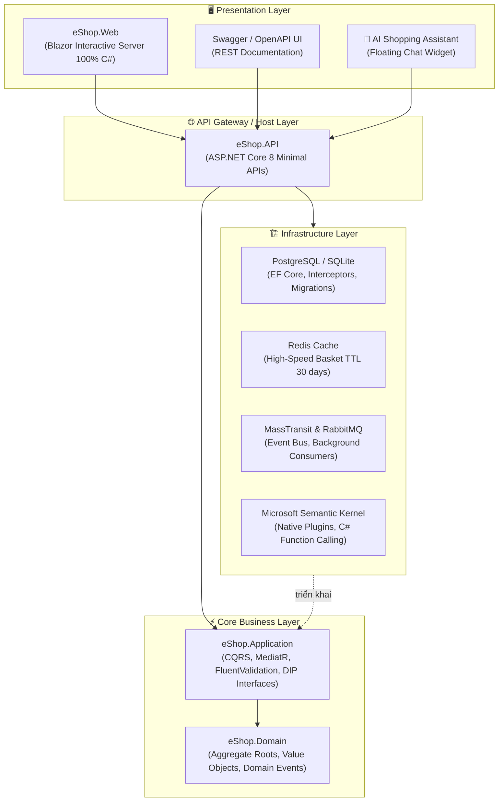

# 🛒 eShop: Cloud-Native Enterprise eCommerce with AI Shopping Assistant

> **Hệ sinh thái Thương mại Điện tử Doanh nghiệp Hiện đại trên nền tảng .NET 8, chắt lọc tinh hoa từ 4 Open-Source Repositories hàng đầu thế giới:**
> 1. [`jasontaylordev/CleanArchitecture`](https://github.com/jasontaylordev/CleanArchitecture) - Kiến trúc Sạch, CQRS, MediatR Pipeline, Domain-Driven Design.
> 2. [`nopCommerce/nopCommerce`](https://github.com/nopCommerce/nopCommerce) - Nghiệp vụ bán lẻ thực chiến, mô hình thực thể Catalog & Ordering.
> 3. [`dotnet/eShop`](https://github.com/dotnet/eShop) - Kiến trúc phân tán Cloud-Native, Giỏ hàng Redis In-Memory, Message Broker RabbitMQ.
> 4. [`microsoft/semantic-kernel`](https://github.com/microsoft/semantic-kernel) - Trợ lý AI thế hệ mới với Function Calling & Dynamic Tool Calling.

---

## 🌟 TỔNG QUAN KIẾN TRÚC HỆ THỐNG

Hệ thống được thiết kế theo mô hình **Clean Architecture** phân tầng độc lập kết hợp với **Kiến trúc Hướng Sự kiện (Event-Driven Architecture)**:



---

## 🚀 CÁC TÍNH NĂNG VÀ PHÂN HỆ NỔI BẬT

| Phân hệ (Module) | Công nghệ chủ đạo | Điểm nhấn kiến trúc |
| :--- | :--- | :--- |
| **Catalog Module** | PostgreSQL, SQLite, EF Core | CQRS Query với `.AsNoTracking()`, Rich Domain Entity chống âm kho, phân trang `PaginatedList`. |
| **High-Speed Basket** | Redis, StackExchange.Redis | Lưu giỏ hàng In-Memory với TTL 30 ngày, xử lý hàng chục ngàn thao tác/giây, tự động fallback InMemory. |
| **Ordering Module** | DDD (Domain-Driven Design) | Aggregate Root `Order`, Value Object `Address`, State Machine trạng thái nghiêm ngặt, Domain Events. |
| **Event Bus (Messaging)** | RabbitMQ, MassTransit | Bắn `OrderCreatedIntegrationEvent` bất đồng bộ; các Consumer ngầm xuất hóa đơn PDF & chuẩn bị kho song song. |
| **AI Shopping Assistant** | Microsoft Semantic Kernel | Tự động kích hoạt **Function Calling (`[KernelFunction]`)** để tra cứu kho hàng và tư vấn theo ngân sách thời gian thực. |
| **Web Portal UI** | Blazor Interactive Server | Giao diện Responsive Bootstrap 100% C#, quản lý giỏ hàng Reactive, tích hợp hộp chat AI trực quan. |
| **Containerization** | Docker, Docker Compose | Đóng gói toàn bộ cơ sở hạ tầng (Postgres, Redis, RabbitMQ, Web, API) chỉ bằng một câu lệnh. |

---

## 🛠️ CẤU TRÚC GIẢI PHÁP (SOLUTION TREE)

```text
d:\eShop\
├── eShop.sln                                # Solution Microsoft .NET 8
├── docker-compose.yml                       # Điều phối 5 Container dịch vụ
├── LEARNING.md                              # Sổ tay bóc tách kỹ thuật & câu hỏi phỏng vấn
├── run-api.ps1                              # Script chạy Web API (Cổng 5000)
├── run-web.ps1                              # Script chạy Blazor Web App (Cổng 5256)
├── run-tests.ps1                            # Script chạy toàn bộ 24 Unit Tests
│
├── src/
│   ├── eShop.Domain/                        # Miền nghiệp vụ lõi (Zero Dependency)
│   │   ├── Entities/ (Brand, Category, Product, Basket, Order, OrderItem)
│   │   ├── ValueObjects/ (Address)
│   │   ├── Events/ (OrderCreatedDomainEvent, OrderPaidDomainEvent, ProductOutOfStockDomainEvent)
│   │   └── Enums/ (OrderStatus)
│   │
│   ├── eShop.Application/                   # Ca sử dụng & Logic nghiệp vụ (CQRS)
│   │   ├── Catalog/ (Queries & Commands với FluentValidation)
│   │   ├── Basket/ (Thêm, sửa số lượng, xóa giỏ hàng)
│   │   ├── Ordering/ (Checkout, Hủy đơn hàng)
│   │   ├── AI/ (Commands & DTOs cho Trợ lý AI)
│   │   └── Common/ (Behaviors, Exceptions, Interfaces: IApplicationDbContext, IBasketRepository, IEventBus, IChatAssistantService)
│   │
│   ├── eShop.Infrastructure/                # Hiện thực hóa hạ tầng công nghệ
│   │   ├── Data/ (ApplicationDbContext, Fluent API Configurations, Migrations, Interceptors)
│   │   ├── Repositories/ (RedisBasketRepository, InMemoryBasketRepository)
│   │   ├── EventBus/ (MassTransitEventBus, OrderNotificationConsumer, OrderStockReservationConsumer)
│   │   └── AI/ (SemanticKernelAssistantService, ShopCatalogPlugin, AiChatTracker)
│   │
│   ├── eShop.API/                           # Điểm vào REST API & Swagger
│   │   ├── Endpoints/ (CatalogEndpoints, BasketEndpoints, OrderEndpoints, AiEndpoints)
│   │   ├── Infrastructure/ (GlobalExceptionHandler chuẩn RFC 7807)
│   │   └── Program.cs
│   │
│   └── eShop.Web/                           # Giao diện Web Blazor Interactive Server
│       ├── Components/Pages/ (Home.razor, Cart.razor, Orders.razor)
│       ├── Components/Shared/ (AiAssistantWidget.razor)
│       └── Services/ (ShopApiClient, CartStateService)
│
└── tests/
    └── eShop.UnitTests/                     # 24 Unit Tests tự động xUnit (Pass 100%)
        ├── Catalog/ (Validation tests)
        ├── Basket/ (Domain logic tests)
        ├── Ordering/ (Aggregate Root & Checkout handler tests)
        └── AI/ (Semantic Kernel Native Plugin & Command tests)
```

---

## ⚡ HƯỚNG DẪN KHỞI CHẠY NHANH

### Cách 1: Khởi chạy Cục bộ (Zero Friction Local Dev)
Hệ thống tích hợp sẵn cơ chế **Dual-Provider** (SQLite + In-Memory Bus + Smart Local AI Engine) giúp bạn chạy ngay lập tức mà không cần cài thêm bất kỳ công cụ nào:

1. **Khởi chạy Web API:**
   ```powershell
   ./run-api.ps1
   # API Swagger: http://localhost:5000/swagger
   ```

2. **Khởi chạy Blazor Web App (ở một cửa sổ Terminal khác):**
   ```powershell
   ./run-web.ps1
   # Web Portal: http://localhost:5256
   ```

3. **Chạy toàn bộ bài kiểm thử tự động:**
   ```powershell
   ./run-tests.ps1
   # Kết quả: 24/24 Passed (100%)
   ```

---

### Cách 2: Khởi chạy Toàn diện bằng Docker Compose (Production-Ready)
Khởi động đồng thời cả 5 dịch vụ (PostgreSQL, Redis, RabbitMQ, Web API và Blazor Web App):

```bash
docker compose up -d --build
```

* **Blazor Web Portal:** [http://localhost:5256](http://localhost:5256)
* **Web API Swagger:** [http://localhost:5000/swagger](http://localhost:5000/swagger)
* **RabbitMQ Management Dashboard:** [http://localhost:15672](http://localhost:15672) (Tài khoản: `guest` / `guest`)
* **PostgreSQL:** `localhost:5432` (DB: `eshop_db`, User: `postgres`, Pass: `postgres`)
* **Redis:** `localhost:6379`

---

## 📚 TÀI LIỆU HỌC TẬP CHUYÊN SÂU

Toàn bộ quá trình tư duy, lý giải câu hỏi **"Là gì? Định nghĩa thế nào? Làm gì trong thực tế?"** và **Bộ câu hỏi phỏng vấn tuyển dụng chuyên sâu cho Senior/Lead .NET** được ghi chép chi tiết tại:
👉 **[LEARNING.md](file:///d:/eShop/LEARNING.md)**

