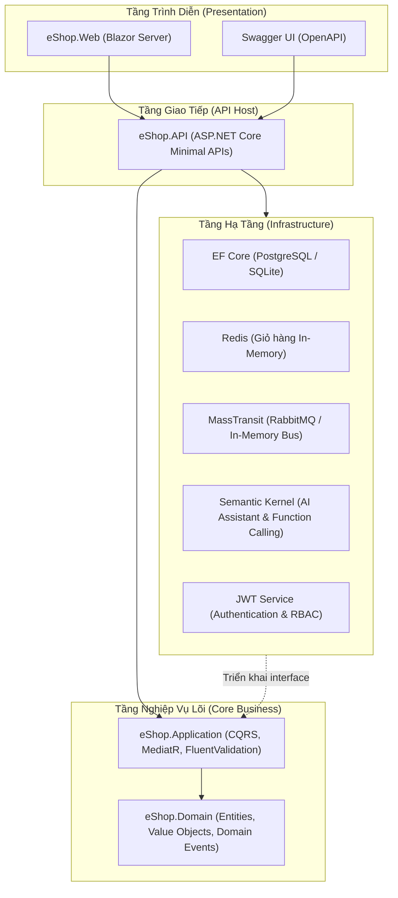

# eShop - Hệ Thống Thương Mại Điện Tử (.NET 8 Clean Architecture)

Dự án ứng dụng web thương mại điện tử xây dựng trên nền tảng .NET 8, áp dụng kiến trúc Clean Architecture kết hợp mô hình CQRS, xử lý dữ liệu phân tán với Redis và RabbitMQ, tích hợp trợ lý AI qua Microsoft Semantic Kernel và giao diện Blazor Server.

---

## 1. Kiến Trúc Hệ Thống

Dự án tổ chức mã nguồn theo mô hình Clean Architecture 4 tầng độc lập, tuân thủ nguyên lý Dependency Inversion (DIP):



### Các nguyên lý và mẫu thiết kế áp dụng:
* **Clean Architecture:** Tách biệt nghiệp vụ lõi khỏi hạ tầng cơ sở dữ liệu và thư viện bên ngoài.
* **CQRS (Command Query Responsibility Segregation):** Tách luồng đọc (Query với `.AsNoTracking()`) và luồng ghi (Command qua MediatR Pipeline).
* **Domain-Driven Design (DDD):** Sử dụng Aggregate Root (`Order`), Entity (`Product`, `Brand`, `Category`), Value Object (`Address`), Domain Events và State Machine quản lý trạng thái đơn hàng.
* **Event-Driven Architecture:** Xuất bản `OrderCreatedIntegrationEvent` qua MassTransit để xử lý bất đồng bộ các tác vụ nền (gửi thông báo, xuất hóa đơn).
* **JWT & Role-Based Access Control (RBAC):** Phân quyền truy cập các endpoint quản trị cho vai trò `Admin` và `Customer`.

---

## 2. Công Nghệ Sử Dụng

| Phân hệ / Tầng | Thư viện & Công nghệ | Phiên bản | Mục đích sử dụng |
|---|---|---|---|
| **Runtime** | .NET SDK (C# 12) | 8.0 LTS | Nền tảng thực thi chính |
| **API Framework** | ASP.NET Core Minimal APIs | 8.0 | Định tuyến HTTP nhẹ, hiệu năng cao |
| **Giao diện Web** | Blazor Interactive Server | 8.0 | Giao diện Single Page Application viết bằng C# |
| **CQRS & Mediator** | MediatR | 12.x | Điều phối Commands và Queries trong Application |
| **Validation** | FluentValidation | 11.x | Xác thực dữ liệu đầu vào trong MediatR Pipeline |
| **ORM** | Entity Framework Core | 8.0 | Truy cập dữ liệu, Code-First Migrations, Interceptors |
| **Cơ sở dữ liệu** | SQLite / PostgreSQL | 8.0 / 16 | Lưu trữ dữ liệu quan hệ (chuyển đổi qua cấu hình) |
| **Bộ nhớ đệm (Cache)** | Redis (StackExchange.Redis) | 2.8+ | Lưu trữ giỏ hàng tốc độ cao (hỗ trợ InMemory fallback) |
| **Message Broker** | MassTransit + RabbitMQ | 8.3+ | Giao tiếp hướng sự kiện giữa các phân hệ |
| **Trợ lý AI** | Microsoft Semantic Kernel | 1.30.0 | Tích hợp LLM, tự động gọi C# Function Calling |
| **Bảo mật** | JWT Bearer Authentication | 8.0 | Xác thực token và phân quyền RBAC |
| **Kiểm thử** | xUnit, Moq | 2.5 / 4.20 | Unit testing tự động cho logic nghiệp vụ |
| **Container** | Docker, Docker Compose | 3.8 | Đóng gói và triển khai môi trường đa dịch vụ |

---

## 3. Cấu Trúc Thư Mục Giải Pháp

```text
d:\eShop\
├── eShop.sln                                # Solution file (.NET 8)
├── docker-compose.yml                       # Docker Compose cấu hình 5 dịch vụ
├── .gitignore                               # Quy tắc loại trừ tệp cho Git
├── README.md                                # Tài liệu kỹ thuật dự án
├── LEARNING.md                              # Sổ tay kiến trúc và kết quả kiểm thử QA
├── run-api.ps1                              # Script khởi chạy nhanh eShop.API
├── run-web.ps1                              # Script khởi chạy nhanh eShop.Web
├── run-tests.ps1                            # Script chạy bộ kiểm thử xUnit
│
├── src/
│   ├── eShop.Domain/                        # Tầng Domain (Không phụ thuộc tầng khác)
│   │   ├── Common/                          # BaseEntity, BaseAuditableEntity, IDomainEvent
│   │   ├── Entities/                        # Brand, Category, Product, Order, OrderItem, BasketItem
│   │   ├── Enums/                           # OrderStatus (Submitted, AwaitingPayment, Paid, Shipped, Cancelled)
│   │   ├── Events/                          # OrderCreatedDomainEvent, ProductOutOfStockDomainEvent
│   │   └── ValueObjects/                    # Address
│   │
│   ├── eShop.Application/                   # Tầng Application (CQRS & Use Cases)
│   │   ├── AI/                              # ChatWithAssistantCommand, DTOs
│   │   ├── Basket/                          # AddItem, UpdateQuantity, RemoveItem, ClearBasket, GetBasket
│   │   ├── Catalog/                         # GetProductsWithPagination, GetProductById, CreateProduct, UpdateStock
│   │   ├── Common/                          # Behaviors (Logging, Validation), Exceptions, Interfaces
│   │   └── Ordering/                        # CreateOrderCommand, CancelOrderCommand, GetOrderByIdQuery
│   │
│   ├── eShop.Infrastructure/                # Tầng Infrastructure (Hạ tầng kỹ thuật)
│   │   ├── AI/                              # SemanticKernelAssistantService, ShopCatalogPlugin
│   │   ├── Data/                            # ApplicationDbContext, Configurations, Migrations, Interceptors
│   │   ├── EventBus/                        # MassTransitEventBus, OrderNotificationConsumer, OrderStockReservationConsumer
│   │   ├── Identity/                        # AuthService (Sinh và xác thực JWT token)
│   │   └── Repositories/                    # RedisBasketRepository, InMemoryBasketRepository
│   │
│   ├── eShop.API/                           # Tầng API Host (Minimal APIs & Middleware)
│   │   ├── Endpoints/                       # AuthEndpoints, CatalogEndpoints, BasketEndpoints, OrderEndpoints, AiEndpoints
│   │   ├── Infrastructure/                  # GlobalExceptionHandler (RFC 7807 ProblemDetails)
│   │   ├── appsettings.json                 # Cấu hình chuỗi kết nối, Redis, RabbitMQ, JWT
│   │   └── Program.cs                       # Khởi tạo DI container và HTTP pipeline
│   │
│   └── eShop.Web/                           # Tầng Web Client (Blazor Server)
│       ├── Components/Layout/               # MainLayout.razor, NavMenu.razor
│       ├── Components/Pages/                # Home.razor, Cart.razor, Orders.razor, Admin.razor
│       ├── Components/Shared/               # AiAssistantWidget.razor, AuthModal.razor, ToastContainer.razor
│       ├── Services/                        # ShopApiClient, CartStateService, AuthStateService, ToastService
│       └── wwwroot/                         # File tĩnh, CSS variables, bootstrap
│
└── tests/
    └── eShop.UnitTests/                     # Dự án kiểm thử tự động (31/31 Passed)
        ├── AI/                              # ChatWithAssistantCommandTests, ShopCatalogPluginTests
        ├── Basket/                          # CustomerBasketTests
        ├── Catalog/                         # CreateProductCommandValidatorTests, PaginatedListTests
        ├── Ordering/                        # CreateOrderCommandHandlerTests, OrderAggregateTests
        └── Security/                        # AuthServiceTests (Đăng nhập, phân quyền, token)
```

---

## 4. Danh Sách REST API Endpoints

### Xác Thực (Authentication)
| Method | Endpoint | Quyền hạn | Mô tả |
|---|---|---|---|
| `POST` | `/api/auth/login` | Public | Đăng nhập tài khoản, nhận JWT token |
| `POST` | `/api/auth/register` | Public | Đăng ký tài khoản người dùng mới (vai trò Customer) |
| `GET` | `/api/auth/me` | Authenticated | Lấy thông tin tài khoản đang đăng nhập từ token (401 nếu thiếu) |

### Danh Mục Sản Phẩm (Catalog)
| Method | Endpoint | Quyền hạn | Mô tả |
|---|---|---|---|
| `GET` | `/api/catalog/products` | Public | Lấy danh sách sản phẩm phân trang, lọc theo Brand/Category, tìm kiếm |
| `GET` | `/api/catalog/products/{id}` | Public | Lấy thông tin chi tiết một sản phẩm (404 nếu không tìm thấy) |
| `GET` | `/api/catalog/brands` | Public | Lấy danh sách thương hiệu |
| `GET` | `/api/catalog/categories` | Public | Lấy danh sách ngành hàng |
| `POST` | `/api/catalog/products` | Admin Only | Thêm mới sản phẩm vào kho hàng (403 nếu quyền Customer) |
| `PUT` | `/api/catalog/products/{id}/stock` | Admin Only | Tăng/giảm số lượng tồn kho sản phẩm |

### Giỏ Hàng (Basket - Redis)
| Method | Endpoint | Quyền hạn | Mô tả |
|---|---|---|---|
| `GET` | `/api/basket/{buyerId}` | Public | Lấy thông tin giỏ hàng của người mua |
| `POST` | `/api/basket/{buyerId}/items` | Public | Thêm sản phẩm vào giỏ hàng |
| `PUT` | `/api/basket/{buyerId}/items/{productId}` | Public | Cập nhật số lượng của một món trong giỏ |
| `DELETE` | `/api/basket/{buyerId}/items/{productId}` | Public | Xóa một sản phẩm khỏi giỏ hàng |
| `DELETE` | `/api/basket/{buyerId}` | Public | Xóa toàn bộ giỏ hàng |

### Đơn Hàng (Ordering - DDD)
| Method | Endpoint | Quyền hạn | Mô tả |
|---|---|---|---|
| `POST` | `/api/orders` | Public | Tạo đơn hàng mới từ giỏ hàng, trừ tồn kho trong transaction |
| `GET` | `/api/orders/{id}` | Public | Xem thông tin chi tiết đơn hàng theo mã Id |
| `GET` | `/api/orders/buyer/{buyerId}` | Public | Lấy danh sách đơn hàng đã mua của một khách hàng |
| `PUT` | `/api/orders/{id}/cancel` | Public | Hủy đơn hàng và hoàn trả lại số lượng tồn kho |

### Quản Trị Hệ Thống (Admin)
| Method | Endpoint | Quyền hạn | Mô tả |
|---|---|---|---|
| `GET` | `/api/admin/metrics` | Admin Only | Xem báo cáo tổng sản phẩm, số đơn hàng và tổng doanh thu |

### Trợ Lý AI (Semantic Kernel)
| Method | Endpoint | Quyền hạn | Mô tả |
|---|---|---|---|
| `POST` | `/api/ai/chat` | Public | Gửi tin nhắn đến AI Assistant, tự động tra cứu dữ liệu sản phẩm |

---

## 5. Tài Khoản Mẫu Để Kiểm Thử (Seeded Users)

Hệ thống đã nạp sẵn 2 tài khoản phục vụ kiểm thử chức năng phân quyền:

| Vai trò (Role) | Email | Mật khẩu | Quyền hạn được cấp |
|---|---|---|---|
| **Admin** | `admin@eshop.com` | `Admin@123` | Toàn quyền: Thêm sản phẩm, điều chỉnh kho, truy cập `/admin` |
| **Customer** | `user@eshop.com` | `User@123` | Người dùng tiêu chuẩn: Xem sản phẩm, mua hàng, xem đơn cá nhân |

---

## 6. Hướng Dẫn Cài Đặt & Khởi Chạy

### Yêu cầu tiên quyết:
* [.NET 8.0 SDK](https://dotnet.microsoft.com/download/dotnet/8.0)
* [Git](https://git-scm.com/)
* *(Tùy chọn)* [Docker Desktop](https://www.docker.com/products/docker-desktop) nếu muốn chạy bằng container

### Cách 1: Khởi chạy Cục bộ (Local Development)

Mặc định ứng dụng sử dụng SQLite (`eshop.db`), InMemory Bus và InMemory Cache fallback, có thể chạy trực tiếp mà không cần cài thêm service ngoài:

1. **Clone repository:**
   ```bash
   git clone https://github.com/Hieuvo1227/eShop_dotNet.git
   cd eShop_dotNet
   ```

2. **Khởi chạy Web API (Cổng 5000):**
   ```bash
   dotnet run --project src/eShop.API --urls "http://localhost:5000"
   # Swagger UI: http://localhost:5000/swagger
   ```

3. **Khởi chạy Blazor Web App (Cổng 5256):**
   Mở một terminal khác và chạy:
   ```bash
   dotnet run --project src/eShop.Web --urls "http://localhost:5256"
   # Web Interface: http://localhost:5256
   ```

---

### Cách 2: Khởi chạy bằng Docker Compose

Khởi động cùng lúc cả 5 dịch vụ: PostgreSQL, Redis, RabbitMQ, Web API và Blazor Web App:

```bash
docker compose up -d --build
```

Kiểm tra trạng thái các container:
```bash
docker compose ps
```

Các địa chỉ truy cập:
* **Blazor Web App:** [http://localhost:5256](http://localhost:5256)
* **Web API Swagger:** [http://localhost:5000/swagger](http://localhost:5000/swagger)
* **RabbitMQ Dashboard:** [http://localhost:15672](http://localhost:15672) (User: `guest` / Pass: `guest`)
* **PostgreSQL:** `localhost:5432` (Database: `eshop_db`, User: `postgres`, Pass: `postgres`)
* **Redis Server:** `localhost:6379`

Dừng toàn bộ dịch vụ:
```bash
docker compose down
```

---

## 7. Kiểm Thử Tự Động (Automated Testing)

Dự án có bộ kiểm thử tự động viết bằng `xUnit` và `Moq` bao phủ các ca kiểm thử cho Domain Entities, CQRS Handlers, FluentValidation rules, Semantic Kernel Plugins và AuthService:

```bash
dotnet test tests/eShop.UnitTests/eShop.UnitTests.csproj
```

**Kết quả kiểm thử:**
```text
Passed!  - Failed: 0, Passed: 31, Skipped: 0, Total: 31, Duration: 1 s - eShop.UnitTests.dll (net8.0)
```

---

## 8. Tài Liệu Kỹ Thuật Chi Tiết

Tài liệu giải thích lý thuyết kiến trúc, giải trình từng tệp mã nguồn và biên bản kết quả kiểm thử chất lượng QA (Happy Path, Sad Path, Transaction Rollback, Security Audit 401/403) được lưu tại:  
👉 **[LEARNING.md](LEARNING.md)**

---

## 9. Giấy Phép (License)

Dự án được phân phối dưới giấy phép mã nguồn mở [MIT License](LICENSE).
